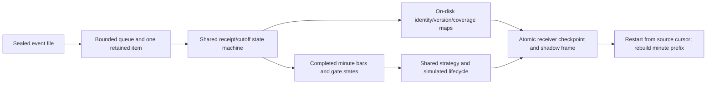

# P2-H5 incremental historical Shadow input

The H4 receipt/cutoff policy now lives in `MinuteIngress`, an incremental state
machine. The existing compiler uses memory-backed maps; H5 uses the same policy
with SQLite-backed maps. H4 controls remain available and continue to pass their
conformance cases. ORB/RVOL features, sizing, costs, order lifecycle and calendar
exits are unchanged.

H5 reads normalized JSONL deliveries incrementally. It seals file bytes through
a chunked hash scan, verifies export metadata when present and enforces a maximum
line size before decoding. No full event tuple or FrozenIngress is compiled.
The sealed CSV still loads as historical universe/calendar/config context; this
release is not a constant-memory live socket service. The shared historical
engine gets each completed minute through a lazy minute-input interface.

An event queue holds at most its configured capacity, plus one producer item
retained when an offer is rejected. Full queues apply backpressure rather than
drop a delivery. Same-clock groups larger than capacity are consumed in chunks
without accumulating a whole group. The receiver closes its watermark only after
all deliveries at that receipt time have been consumed; the exact-end, zero-grace
policy is retained. Queue capacity, line bound and execution profile are declared
in the run manifest, so restart cannot silently change them.

The file parser may prefetch beyond the last committed cutoff. A cursor therefore
records the last **consumed** event's byte offset, physical line number and prefix
SHA, not the file handle's current read-ahead position. EOF includes trailing
whitespace. A source fingerprint is checked before further reads/commits and the
complete content hash is verified at EOF. Clock regression, duplicate JSON keys,
oversized lines, source/file seal drift and event ambiguity fail closed.

Delivery identities, revisions, coverage, gaps, connection sequences, readiness
states and audit rows stay in normalized SQLite maps. Each row's SHA256 binds its
space, key and canonical value. An incremental SHA256 XOR aggregate plus row count
seals the map set; the small control state and source cursor bind that seal into
the existing ordered frame hash chain. Startup scans the maps and compares the
last checkpoint against the last committed frame before continuing. This is
integrity checking, not authentication against an adversary able to rewrite all
hashes and input files.

Receiver maps, source cursor, control/watermark state and the simulated minute
frame commit in **one SQLite transaction**. A failure during event ingestion or
between checkpoint preparation and frame commit rolls back to the preceding
minute. The normal SQLite hot-rollback recovery occurs under the independent
journal lease. The supervisor also holds the H3 run-directory lease; both release
on process death. Source state cannot acknowledge an event without the associated
minute result. A large same-clock batch can take time but never finalizes a
partial group to bypass backpressure.

On restart, the receiver restores its committed state directly and seeks to its
byte cursor. Prior source bytes are scanned only for hash verification; prior
event JSON is not decoded. The strategy/features/account and fresh local
ScriptedBroker still rebuild by replaying **stored minute snapshots**, verifying
the exact shadow prefix before appending. H5 never replays against an existing
real or persistent broker. A completed repeat parses zero events and appends
zero frames. Operational prefetch/backpressure statistics are outside deterministic
frames, so restart statistics do not change trading history.

The historical simulation executes only once a completed minute has been
received, while retaining the existing modeled-open/bar-interval fill timestamps.
Minute audit copies label the market input's `as_of`. These prices/timestamps
are model conventions, not measured realtime fills. Post-session receipts enter
the final later audit after the last closing frame and suppress admissible
performance when critical. An unconditional end-of-replay hook drains the final
source even if earlier data/orders already made the run incomplete.

The H3 atomic health, attempt-specific cooperative stops and crash/stall inspection
are reused. New inputs/changed limits require a new journal. Queue bounds apply
to ingestion; finite CSV context, calendar, strategy report arrays and disk
history still grow with the selected historical horizon. Actual orders and paid
realtime remain disabled. Next: paper-adapter query/update/reconciliation contracts
and an execution gateway kept off, using recorded/fake broker responses.
