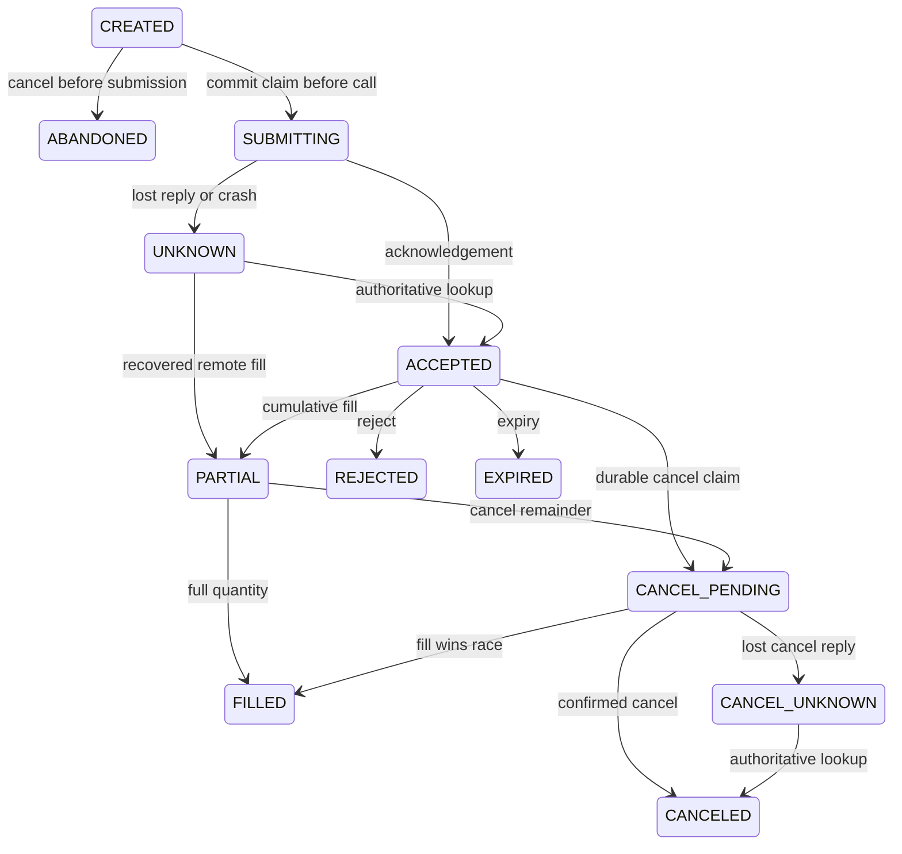

# P2-H1 — Offline order lifecycle and reconciliation

This historical-first checkpoint adds a persistent order book and an independent
scripted broker. It needs no market-data subscription, credentials or network.
The coordinator accepts the local `ScriptedBroker`; no real broker adapter,
endpoint or activation switch is implemented. P1-H strategy/cost parameters and
Sentinel are unchanged.

## Durable intent and order states

A quantity `TradeIntent` becomes a validated whole-share `OrderRequest` with a
stable intent ID, strategy, symbol/side, reservation price and fee budget.
`client_order_id = dx27h-<32 hex characters>` hashes the run namespace and intent
ID. Repeated identical preparation returns the same order; a conflicting payload
with the same ID halts. Namespace, initial cash and contract are sealed in SQLite.

The submission claim commits **before** calling the simulator. A timeout or a
crash after the claim cannot prove whether the request reached the broker. Keep
the original client ID and reconcile. A not-found response leaves the order
UNKNOWN and pauses new intents; no automatic resubmission or replacement ID is
created. A fresh process always starts unreconciled. Repeated submission of a
claimed/resolved order makes no second simulated submit call.

Unsent CREATED intents can be abandoned locally without a broker cancel call.
Known active orders can be canceled while new submissions are paused. A missing
cancel acknowledgement remains uncertain until a terminal authoritative report;
an active snapshot is not permission to blindly repeat the cancellation.

## Cumulative report accounting

The simulator contract uses cumulative whole-share quantity, executed notional,
fees, immutable order identity, event ID and a monotone per-order revision.
These are **simulator** revisions, not claimed Alpaca fields. Money is finite,
bounded Decimal with at most eight places. The report fee is cumulative fill
commission; pre-fill/cancellation charges and fill-price corrections are not
modeled.

Each new revision applies only the quantity/notional/fee delta, atomically with
order state, report deduplication and an audit seal. Exact event duplicates have
no effect; a new transport event with the same identical revision has no economic
effect; unseen older revisions are recorded as stale. Conflicting IDs/revisions,
identity changes, cumulative regression, repricing the same quantity or invalid
terminal transitions halt without changing cash or positions. A later valid
fee revision is applied once. Confirmed cancellation does not erase partial
fills or refund executed notional. A later authoritative cancellation/fill race
can increase cumulative fills, including a full fill after cancellation.

Cash is debited/credited from reported notional and commissions, and positions
from reported quantity. Valid reported executions that exceed local cash/price/
fee budgets remain recorded, then halt new intents; the ledger never pretends
an already reported execution did not occur. Buy reservations cover remaining
quantity and outstanding fees; sell reservations cover remaining shares and
fees. CREATED, accepted, partial and uncertain orders retain reservations.
Reservations are checked again before submission, so a late fill cannot cause
a prepared exit to oversell, or a pending sell fee to be spent by a prepared buy.

## Reconciliation and persistence

The independent local broker commits its account/orders separately from the
order book. A complete snapshot contains current cash, positions and one latest
report for every submitted order in the dedicated offline account, including
terminal history. Reconciliation applies known report deltas and compares cash
and positions exactly; it never overwrites the ledger to hide differences.
Missing orders, stale/incomplete snapshots, unknown broker orders, cash/position
mismatch or unavailable snapshots pause new intents. A later complete consistent
snapshot may resolve temporary uncertainty. Integrity/budget halts are sticky;
there is no automatic clearing or real-execution enable command.

SQLite FULL synchronization, rollback transactions, exclusive crash-safe leases
and chained audit records protect each derived-state update. State and its audit
seal commit together. Restore checks the manifest, entire audit chain and current
state digest. Source journals are opened read-only; a mismatching database is
refused before schema mutation. Storage keeps full bounded test state as JSON,
not a scalable production event store. Whole shares, dedicated flat initial
accounts and cumulative simulated reports are deliberate limits.

## Historical trace acceptance and remaining work

A completed P1-H journal supplies fixed modeled fills. Each is converted through
`TradeIntent` into a stable request, and its modeled executed notional/commission
are split into partial and final cumulative reports, with duplicate partial
reports injected. Repeated completed traces make zero new submit calls. Final
cash/positions are checked against the original modeled ledger.

This verifies lifecycle accounting and recovery on authentic old data. It does
not feed delayed/partial reports back into strategy decisions, simulate market
queues, prove profitability or test Alpaca order behavior. The next P2-H2 step
connects asynchronous order/account state to the historical minute decision loop
and checks sizing, stops, risk halts, flattening and signal timing under delayed,
partial, rejected and uncertain outcomes. Real paper integration remains a
separate gate.

See [executed acceptance](../reports/intra-p2-h/validation.md) and
[Windows/Linux run instructions](../operations/intraday-order-lifecycle.md).
