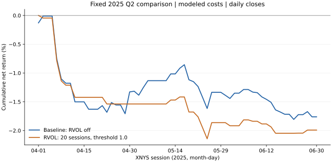

# INTRA-1C：2025 Q2 固定历史对照

**本期两组均亏损，固定 RVOL 筛选未显示净收益优势。** 基线扣费后收益 -1.7611%，
RVOL 组 -1.9911%；预先声明的主要差值为 **-0.2300 个百分点**。
配对区块 bootstrap 的 95% 描述区间为 **[-1.3268, +0.6880] 个百分点**，覆盖零。
本次没有建立策略优越性或盈利能力，不调整参数、不开启 RVOL 默认筛选，也不启用下单。

## 方案先于评价数据

[固定方案](../../research/intra-1c/protocol.md)及
[机器协议](../../research/intra-1c/q2-2025-protocol.json)在提交
[`b69aea5`](https://github.com/Daxoniel/DX27-Trading-Engine/commit/b69aea5)中封存，
并先创建公开 [PR #53](https://github.com/Daxoniel/DX27-Trading-Engine/pull/53)。
配对运行代码在 `828bbe34f121d2f1226b8a69237e4d184ea54c8f` 提交后才开始抓取数据。
封存协议、首个公开 PR、实现提交和数据抓取的时间顺序已经核对。
见 [acceptance.json](acceptance.json)。

协议 SHA-256：`62731c4e45200b689d099da1acb5b5309d817b9bfe1e35bb5b370343dd266a17`。
49 个注册引擎源码文件未变，运行依赖与协议一致。`.gitattributes` 保持这些文件
及协议的 LF 字节格式，避免 Windows 换行转换使源码指纹失效。

Q2 是本项目首次注册执行的该时期分钟策略评价，按已查看 Q1 后的下一季度选择，
未搜索其他时期。该声明不代表全市场信息从未被接触，也不是前瞻盲测。
**Q2 现在已经被查看，不能再用于后续调参后的独立、未查看验收。**

## 数据与共同配置

- SPY、QQQ、IWM；Alpaca SIP、1 分钟、raw 调整。
- 请求 `[2025-03-01T00:00Z, 2025-07-01T00:00Z)`，共 210,215 条源分钟线。
- 83 个 XNYS 交易日、97,110 条常规时段线；3 月 21 日只预热，Q2 62 日全部评价。
- 两组初始现金均为 100,000；同一 ORB/ADX/ATR、风险上限、成交延迟和成本。
- A 关闭 RVOL，B 仅开启前 20 个计划交易日开盘区间均量、RVOL ≥ 1.0。

完整源码配置、依赖、两组账本摘要和协议/输入散列见 [comparison.json](comparison.json)。
CSV SHA-256 为 `d4a4bfcbaf27f549f5289a616ca6234737421829486681a76fba9764d85ca7a5`；
canonical 响应档案 SHA-256 为
`b82fdbb13197cab95db817e3412ad5682d2671da067a01318af71735ca6f7b6c`。
原始行情、响应档案与完整逐笔/分钟账本保留在本地 work 目录，未提交原始市场数据。

## 注册指标

| 指标 | A：基线，RVOL 关闭 | B：固定 RVOL 开启 |
| --- | ---: | ---: |
| 扣费后净损益 | -1,761.09 | -1,991.09 |
| 扣费后净收益率 | -1.7611% | -1.9911% |
| 期末现金/权益 | 98,238.91 | 98,008.91 |
| 分钟权益最大回撤 | 2.5815% | 2.8620% |
| 已结束交易数 | 99 | 39 |
| 胜率（净盈利交易/全部结束交易） | 33.33% | 23.08% |
| 模型佣金 | 73.17 | 28.78 |
| 模型点差成本 | 479.97 | 187.88 |
| 模型滑点成本 | 479.97 | 187.88 |

图为每日收盘累计净收益；表中的最大回撤按分钟权益计算。
RVOL 减少了交易次数及模型成本，但该样本净损益更差。
这里没有以结果重新选择阈值、股票池、时期、成交配置或成本参数。

## 配对与独立核对

62 个评价日逐日配对，保留基线 20 个及 RVOL 41 个零收益日，未删除亏损或不交易日。
RVOL 评价期有 186 条 symbol/session 记录：77 条入选、109 条低于阈值，
没有评价期历史不足或开盘缺失拒绝。完整上下文摘要中的 80 条入选含预热期记录，
不能当作 Q2 入选数。

两组均 COMPLETE_REPLAY，数据质量问题表为空，最终无持仓；3 月没有成交。
198/78 个成交片段分别对应 99/39 个结束交易，买入均严格晚于决策时点。
独立重算验证现金流、已结束交易净损益、逐分钟 cash+holdings、费用合计、
日收益复合及分钟最大回撤。现金/PnL 残差均小于 0.000001；逐日收益见
[paired-daily.csv](paired-daily.csv)。

区间严格使用注册的配对循环 5 日区块、10,000 次、PCG64 种子 20251015，
两组共用抽样索引。单季度、少量交易、区块选择和近似平稳假设限制了解释范围。
原始分钟可用时点仍假设为 bar end，未验证 PIT 发布、NBBO 队列或市场冲击。
完整成交模型没有改用 H2 半量成交，也没有验证实际 paper 成交或费用。

底层工程引擎继续保留 `effectiveness=NOT_EVALUATED`；外层是完成的固定历史描述性
比较，`effectiveness=NOT_ESTABLISHED`、`execution_enabled=false`。
后续若研究算法，应先声明训练/验证划分及试验预算，不能拿本次已查看的 Q2
反复选参后再宣称独立通过。自动 paper 执行缺口仍见
[框架就绪审查](../intraday-framework-readiness/validation.md)。
