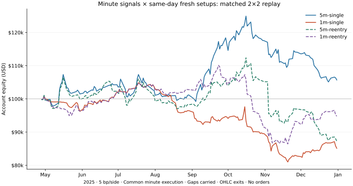

# Minute signal and same-day fresh-setup experiment

This is the preregistered matched 2×2 follow-up to [PR81](https://github.com/Daxoniel/DX27-Trading-Engine/pull/81), testing the user’s proposed one-minute signals and same-day reentry. **Historical simulation only; no broker orders.** The previously examined 2025 sample is not independent out-of-sample evidence.

[Protocol and method](../../research/martin-luk/minute-reentry.md) · [Frozen protocol](../../research/martin-luk/minute-reentry-protocol.json) · [Execution code seal](../../research/martin-luk/minute-reentry-code-seal.json) · [Pre-outcome publication receipt](protocol-publication.json)

## Comparison

The four cells share 172 sessions, 2025-04-28–2025-12-31, $100,000 initial cash and 7,994 candidate stock-days. Daily selection/support, risk limits, the three-bar flush/recovery pattern, first-two-hour gate, five-minute expiry and exit rules stay fixed. All four share a one-minute quote-entry clock. The factor changes are signal-bar duration and permission for a fresh same-day attempt after becoming flat or an unfilled order ends.

**The new five-minute control is not the old PR81 baseline.** Common changes include the minute execution clock, local three-bar gap recovery, exact-cent limit rounding, intrabucket management using only post-entry minutes and causal observation/cash timing. Comparing its return with PR81 cannot isolate any one of these changes. Within this experiment, the two factors are compared under matched controls.

Three one-minute bars span three minutes; three five-minute bars span fifteen. This intervention changes stop geometry as well as speed. Reentry requires three fresh contiguous bars starting at/after the previous known terminal event; no reuse of a stopped setup or overlapping same-name positions. Reattempts after an unfilled signal are reported separately from purchases after a previous intraday position closes.

## Results

All four primary-cost runs process all 172 sessions. Stress-cell halts are disclosed below; no full-period return is reported after a halt. Results include open positions marked at the last available price; no terminal forced sale or return annualization. Each cell reruns the shared account from scratch.

| Signal / attempt policy | Return, 5 bp/side | Closed win rate | Observed max drawdown | Entries | Profit factor |
|---|---:|---:|---:|---:|---:|
| 5m-single | +5.70% | 10.39% | 16.63% | 310 | 1.115 |
| 1m-single | -14.88% | 5.08% | 24.26% | 435 | 0.562 |
| 5m-reentry | -12.71% | 9.84% | 22.77% | 388 | 0.692 |
| 1m-reentry | -5.21% | 4.16% | 24.41% | 605 | 0.850 |

At primary cost, 1-minute signals alone lower return by 20.58 percentage points. Allowing fresh attempts improves the 1-minute result by 9.67 points, but the joint change remains 10.91 points below the matched 5-minute single-attempt control, with only 4.16% closed-trade wins. This does not support adopting either change as a reliable improvement. The control itself reverses to a loss under cost stress; no version is promoted to Paper from these results.



### Cost stress

| Cell | Return, 25 bp/side | Closed win rate | Observed max drawdown | Entries |
|---|---:|---:|---:|---:|
| 5m-single | -15.07% | 11.08% | 24.52% | 318 |
| 1m-single | HALTED: no full-period return | — | — | 178 before halt |
| 5m-reentry | -21.19% | 9.73% | 26.12% | 371 |
| 1m-reentry | -44.76% | 2.79% | 46.67% | 827 |

- 1m-single-25bp: 56 sessions processed; halt `{"action_kind": "spin_offs", "code": "UNRESOLVED_CORPORATE_ACTION", "date": "2025-07-17", "symbol": "ENVX"}`. Partial-period trade statistics in results.json are not full-period comparators.

The cost assumptions are adverse execution adjustments, not a verified broker fee schedule. Higher-cost cells rerun quote eligibility, quantities and account capacity; they are not fee deductions from the primary ledger.

### What changed in the primary cells

| Cell | Signal attempts | First fills after earlier unfilled attempts | Filled intraday reentries | Median actual initial stop distance |
|---|---:|---:|---:|---:|
| 5m-single | 2447 | 0 | 0 | 1.16% |
| 1m-single | 3231 | 0 | 0 | 0.76% |
| 5m-reentry | 3778 | 109 | 17 | 1.05% |
| 1m-reentry | 11135 | 196 | 182 | 0.60% |

The intervention permits fresh attempts after failed orders as well as after a filled position closes. The aggregate effect is therefore broader than a stopout-only reentry rule. Initial stop-risk budgets do not cap realized gap losses; worst realized R and largest closed loss are retained for each cell. The subgroup P&L in [results.json](results.json) describes realized trade paths; it cannot attribute the whole-account return difference to those trades, because cash, exposure and later eligibility change too.

Matched return differences, percentage points (not statistical significance or independent validation):

- 5 bp/side: 1m vs 5m without reentry -20.58 pp; reentry at 5m -18.41 pp; reentry at 1m +9.67 pp; joint change vs 5m-single -10.91 pp.
- 25 bp/side: incomplete; no four-cell full-period comparison.

### Strict completeness and independent checks

| Cell, 5 bp/side | Sessions processed before halt | Halt |
|---|---:|---|
| 5m-single | 1 | `{"at": "2025-04-28T13:58:01+00:00", "code": "HELD_POSITION_BAR_MISSING", "symbol": "SLNO"}` |
| 1m-single | 15 | `{"at": "2025-05-16T14:50:01+00:00", "code": "HELD_POSITION_BAR_MISSING", "symbol": "GOGO"}` |
| 5m-reentry | 1 | `{"at": "2025-04-28T13:58:01+00:00", "code": "HELD_POSITION_BAR_MISSING", "symbol": "SLNO"}` |
| 1m-reentry | 4 | `{"at": "2025-05-01T13:49:01+00:00", "code": "HELD_POSITION_BAR_MISSING", "symbol": "SDGR"}` |

Strict checks withhold a full-period return after the first held-position data gap. The conditional curves carry observed marks through gaps and are not certified NAV; observed drawdowns are not guaranteed intraperiod maxima.

Every primary, stress and strict ledger passes the independent Decimal account/quote audit and the raw signal-window/reentry audit. Checks verify input consistency, entry timing/size/price, no overlapping same-name positions, three contiguous bars, fresh bars after a terminal event and realized R. They do not authenticate the provider or verify exit quotes. [Machine-readable results](results.json) include every audit and private artifact hash; [quote-source manifest](quote-source-manifest.json) indexes the retained response seals. Software validation is recorded in [validation.json](validation.json).

## Source and execution limits

926,329 raw minute rows were captured in 178 response pages for candidate opening windows. Normalization filters the provider’s inclusive end boundary. All 198,401 derived opening five-minute bars compared with the previous source match in open/high/low/close/volume. Missing minutes are never filled synthetically; missing OHLC bars need not mean no trades occurred.

Entries use the latest regular-condition historical SIP quote no later than the execution instant, no older than 60 seconds, with adverse ask price, displayed-size cap, fixed round-lot support and residual cancellation. Stops, partials and daily exits remain conditional OHLC price proxies, without independent sell-side quote/depth verification. Gap-carry NAV can understate unobserved intraperiod losses. Fixed cohort/security identity, sectors and final-source availability are not certified historical point-in-time inputs.

Raw quotes, prices and trade ledgers stay private. Public artifacts contain aggregate account metrics and hashes: [input manifest](input-manifest.json), [minute-source manifest](minute-source-manifest.json). Hashes and independent accounting checks establish consistency with retained inputs, not vendor authenticity or execution certainty. No paid data access was purchased, no 2026 holdout prices were fetched, and no orders were sent.

## Reproduce

See the method’s capture/normalize/replay commands, then:

```sh
python research/martin-luk/summarize_minute_factorial.py --root work/mlp3 --manifest work/mlp3/normalized/manifest.json --output docs/reports/martin-luk-minute-reentry
python research/martin-luk/plot_minute_factorial.py --results docs/reports/martin-luk-minute-reentry/results.json --output docs/reports/martin-luk-minute-reentry/equity.svg
```

The summary reruns independent raw-quote/account audits and reconstructs the raw three-bar signal and fresh-window conditions for each entry. The exact one-minute template and fixed exits are DX27 research choices; the sources do not establish that they reproduce Martin Luk’s discretionary decisions.
