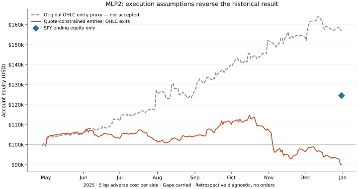

# MLP2 portfolio replay: conditional historical diagnostic

**Current implementation fails this diagnostic.** After replacing unsupported
trade-bar entry prices with past quote prices and displayed ask capacity, all
three cost cases lose money. The earlier +57.05% OHLC-entry result is retained
as a rejected execution-model diagnostic, not adopted as evidence of an edge.
All runs use the already examined 2025 period, not an independent test.

## Corrected entry model: 2025-04-28 through 2025-12-31

| Adverse cost per side | Conditional return | Observed bar-close max drawdown | Closed trades | Closed win rate | Profit factor |
|---|---:|---:|---:|---:|---:|
| 5 bp | −9.95% | 21.72% | 325 | 7.38% | 0.745 |
| 10 bp | −20.25% | 26.53% | 351 | 7.98% | 0.556 |
| 25 bp | −23.96% | 29.36% | 335 | 9.25% | 0.506 |

These are **OBSERVED_ONLY diagnostics**: entry quote evidence is checked, but
stops/partials/exits remain OHLC proxies and absent held bars carry stale marks.
The 5-bp run records 120 unobserved held bars. The corrected strict HALT run
stops in session 4, at IRTC on May 1, and has **no complete-period return**.
Neither the negative diagnostics nor the strict halt are real broker outcomes.
No orders were sent and this implementation is not promoted to strategy Paper.

The same-period SPY comparison returns +24.57%, with gross cash dividends and
the assumptions below. Average observed gross exposure is 24.08% for the 5-bp
strategy; SPY is fully invested, so the comparison is not risk-adjusted alpha.

The blue marker is only SPY's final equity, not an interpolated benchmark path.
The gray curve is the rejected OHLC-entry proxy, not a competing validated model.

## Why the apparent positive result did not survive

1. The original 5-bp proxy returned +57.05%, 100 closed trades, 20% win rate and
   7.00% observed drawdown. Its two largest closed winners, ARWR and AMSC,
   contributed 61.67% of net closed-trade PnL. This is concentration attribution,
   not a counterfactual result with those trades removed.
2. Winner inspection found that AMSC has no eligible minute bar at the modeled
   14:15 opening, despite a 14:15:01 order expiry. The five-minute aggregate's
   opening price is not proof of a trade at its timestamp. TVTX quote updates
   inside the modeled one-second window did not support the buy limit. No quote
   updates in a window do not prove no carried quote existed; the corrected
   model obtains the latest quote at or before the decision instead.
3. The replacement uses the latest regular SIP quote no older than 60 seconds,
   never a later quote or a future bar open. Ask plus cost must fit the limit.
   Quantity is capped at displayed ask round lots times 100; residual quantity
   is cancelled. Quotes above $250 are skipped because this diagnostic does
   not certify their lot size. These are explicit execution assumptions, not
   purported Luk selection rules. The whole shared account is rerun.
4. In the corrected 5-bp run, 168 of 327 entries are partial. There are 477
   ask-above-limit rejections, 25 missing quotes, 19 unverified lot-size cases
   and 11 quotes already below protection. Entry ask is a median 10.61 bp above
   the later aggregate trade open; 95 asks exceed that five-minute trade high.
   This can reflect spread/timing/aggregation, not necessarily a vendor error.
   Trade prices cannot substitute for executable offers.
5. Of 325 closed trades, 294 end at a modeled stop and 31 at the daily trailing
   exit. Average closed win is $1,249.84 versus average loss $133.75. Those
   realized sizes require about 9.67% wins to break even, above the observed
   7.38%. This is descriptive arithmetic, not an independent future win-rate
   estimate. KTOS and AMRC losses are about 4.47 and 4.07 times initial modeled
   stop risk: gaps and absent observations prevent a tight stop from bounding
   realized loss.

The sign reversal jointly reflects entry price/time, displayed-size partial
fills, gap cancellation, and subsequent account paths; no isolated causal
ablation establishes each component's contribution. It is not merely a fixed
fee subtraction. Do not widen stops, delete losing symbols or select a sector
from this exposed period to restore a preferred result.

The implemented setup is an incomplete long-pullback approximation, not Luk's
complete discretionary method. Its present negative result does not validate
the desired high-win-rate strategy. The next research question is whether the
actual base/first-pullback and entry confirmation have been represented
faithfully, using prespecified chart review and full execution checks before
another protocol—not a parameter search against these returns.

Artifacts: [corrected results](results-quote.json),
[rejected OHLC-entry results](results.json),
[winner execution checks](winner-data-checks.json),
[quote/bar comparison](quote-bar-comparison.json),
[quote source seals](quote-source-manifest.json),
[quote execution protocol](../../research/martin-luk/quote-execution-protocol.json).

Every corrected buy is independently checked against its sealed raw response
for source binding, no future/stale quote, regular condition, price, limit,
protection and displayed capacity. All four corrected account audits pass.
This verifies input/account consistency, not true source completeness or fills.

Protocol: [replay-v2-protocol.json](../../research/martin-luk/replay-v2-protocol.json).
Method and reproduction: [replay-v2.md](../../research/martin-luk/replay-v2.md).
The original MLP1 implementation and MLP2 scanner remain unchanged.

## First held-bar gap: why no bar does not mean no trade

The original OHLC-entry primary stops on SLNO at 2025-04-29 16:20 UTC, session 2. No minute bars
are returned inside that five-minute interval, although flanking minutes have
bars. A separate historical SIP trade request returns 26 trades: 25 carry odd
lot condition `I`; the remaining trade carries average-price `W` and derivative
price `4`. Every trade has at least `I` or `W`.

Alpaca's [official aggregation rules](https://docs.alpaca.markets/us/docs/market-data-faq)
say that `I` and `W` do not update OHLC prices, that the strictest condition
applies when several coexist, and that incomplete OHLC bars are not emitted.
The observed absence is therefore consistent with documented aggregation,
rather than evidence that no trading occurred or proof of a feed outage.
It does not establish executable prices for the strategy's protective orders.
No fabricated flat bar was inserted and the primary halt was not erased.

Probe evidence is summarized without trade prices in
[gap-investigation.json](gap-investigation.json) and
[gap-trades-summary.json](gap-trades-summary.json). The raw response stays private.
Other absent bars have not all been individually classified by trade condition.

## Data, execution and accounting limits

Supplemental capture adds 1,050,135 raw five-minute rows in 466 cached response
pages, including SPY corporate actions. There are 453 normalized raw symbol
files: 452 candidate names and SPY. Existing source rows are reused with hashes;
overlapping source revisions cannot silently replace recorded values. Raw data
and full trade/account ledgers remain private.

Each signal becomes available one second after its five-minute close. Entry
is only at a later five-minute open within the limit after adverse cost. This
coarse delay, absence of bid/ask and unverified explicit fees prevent a claim
of executable performance. The observed-only diagnostic carries stale marks
across absent bars and processes orders at the next observed bar; its return
is neither an estimate of fills inside gaps nor a guaranteed performance bound.

Daily exits use previous vendor daily close and EMA9, with liquidation at the
next observed regular open. A triggered liquidation persists across an entire
unobserved session, even if a later daily EMA recovers. A regression test covers
this execution fix; no selection thresholds were tuned to returns.

The archived fixed name-filter cohort is not a certified dynamic common-stock
universe. Sector classifications and tradability are not historically verified.
Final revised bars and retrospective actions do not establish first availability.
Daily AVWAP and the higher-low/base proxy do not reproduce Luk's discretion.
No same-session reentry, overnight protective fill, interest, contributions,
tax withholding or dividend reinvestment is modeled. Cash dividends use gross
entitlements and remain receivables until payable. Unresolved held corporate
actions/fractional entitlements halt both gap policies.

The SPY comparison starts at the same initial regular open with the 5-bp entry
cost, holds whole shares, retains gross dividends in cash/receivables and marks
the final regular close without a forced sale. It is a period-specific passive
comparison, not a benchmark-adjusted causal estimate of skill.

Source/input seals: [source-manifest.json](source-manifest.json),
[input-manifest.json](input-manifest.json),
[protocol-publication.json](protocol-publication.json). The protocol was public
before supplemental capture; the input manifest and final execution code were
published before the final replay outcomes. Earlier interrupted diagnostics
and the first primary gap were visible during implementation verification.
