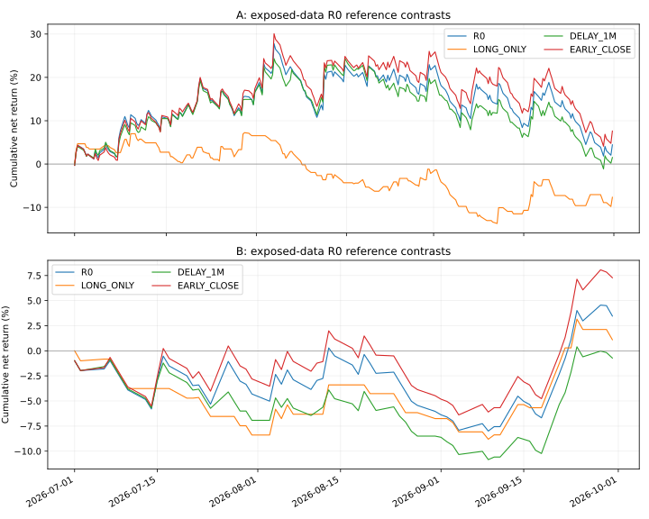

# R0 锚定的单因素探索性重放

A/B 均已暴露，此次不能提供新的独立效果确认。按[固定协议](../../../research/orb-reference-contrasts/protocol.md)只执行 R0 参照及三个单因素变化：只做多、入场延迟一分钟、提前五分钟平仓。没有组合搜索、赢家选择或生产参数修改。协议和实现先在 PR #63 的 `a2a15be` 公开并逐字核对，再运行旧数据，见[发布记录](protocol-publication.json)。

**只做多和一分钟延迟，在 A、B 都降低了 R0 模型收益；提前五分钟平仓则在两期都提高了收益。** 这推翻了“提前退出一定拖累本次模型”的预设，但不构成可部署策略的盈利证据。

所有组的成本与风险仍为 R0：$25,000 起始、每日资本衔接、1%价格风险预算、4倍名义上限、$0.0005/股、无最低费/点差/滑点；多空可得性、退出完整成交和分钟路径都理想化。LONG_ONLY才关闭空头。结果不能直接外推到有不同资金、成本和限制的R1。

## 完整结果

收益差为该组净收益减同阶段R0，单位百分点；最大回撤按分钟末权益采样。

| 阶段 | 固定组 | 净收益 | 相对R0差 pp | 最大回撤 | 交易数 | 净损益 USD |
|---|---|---:|---:|---:|---:|---:|
| A | R0 | +4.4413% | +0.0000 | 22.3863% | 251 | +1110.31 |
| A | LONG_ONLY | -7.6666% | -12.1078 | 21.0399% | 122 | -1916.64 |
| A | DELAY_1M | +1.5158% | -2.9255 | 22.5263% | 239 | +378.94 |
| A | EARLY_CLOSE | +7.6186% | +3.1774 | 22.0727% | 251 | +1904.66 |
| B | R0 | +3.4613% | +0.0000 | 10.0173% | 63 | +865.34 |
| B | LONG_ONLY | +1.1024% | -2.3589 | 9.8722% | 31 | +275.61 |
| B | DELAY_1M | -0.7214% | -4.1827 | 11.7205% | 60 | -180.34 |
| B | EARLY_CLOSE | +7.2793% | +3.8179 | 9.7623% | 63 | +1819.82 |

LONG_ONLY重新计算自己的每日仓位和资金路径，因此A的 −$1,916.64 不等于上一轮原R0多头贡献 −$2,577.91；B的 +$275.61 也不等于原多头贡献 +$264.19。这是对照重放与原记录分组的区别，不是账本不一致。

DELAY_1M在A有12天、B有3天因非正风险距离不交易；加上B的1天doji，对应零交易日为A12/B4。原R0为A0/B1；LONG_ONLY为A129/B33；EARLY_CLOSE为A0/B1。这里的12/3包括多空方向，不能混同于原R1只做多的7/1天非正R诊断。延迟后的风险距离、10R价格、整数股数和后续资金路径均会改变，差值不只是固定仓位上少持有一分钟的损益。

提前退出组按实际日历在收盘前五分钟开盘退出剩余持仓；开盘跳空止损/目标优先，计划退出优先于该分钟后续high/low。这个退出执行约定是该对照因素的一部分。EARLY_CLOSE保持交易方向/有无交易日数，但会改变退出价格和后续仓位。不能据结果将其选为“最佳版本”，也不能将三个单因素差值相加解释R1。



## 全部预定固定成交额成本情景

下列为净损益USD，在R0既有佣金外，对每次填单的参考成交额增加0/1/2/5bps成本，**固定成交，不重新定仓或重放**。这是项目情景，不是实际费用校准。所有组/阶段/情景完整保留。

### A 期

| 额外bps/填单 | R0 | LONG_ONLY | DELAY_1M | EARLY_CLOSE |
|---|---:|---:|---:|---:|
| 0 | +1110.31 | -1916.64 | +378.94 | +1904.66 |
| 1 | -3887.90 | -3977.45 | -4301.66 | -3171.95 |
| 2 | -8886.12 | -6038.25 | -8982.27 | -8248.57 |
| 5 | -23880.78 | -12220.65 | -23024.09 | -23478.41 |
### B 期

| 额外bps/填单 | R0 | LONG_ONLY | DELAY_1M | EARLY_CLOSE |
|---|---:|---:|---:|---:|
| 0 | +865.34 | +275.61 | -180.34 | +1819.82 |
| 1 | -128.14 | -208.30 | -1096.00 | +810.68 |
| 2 | -1121.61 | -692.22 | -2011.66 | -198.46 |
| 5 | -4102.03 | -2143.96 | -4758.64 | -3225.87 |

A期即使EARLY_CLOSE在低成本模型下提高收益，额外1bps/填单后仍转为亏损；B的EARLY_CLOSE在额外1bps下为正、2bps下为负。其余组B额外1bps均为负。不能从B的有利情景选出费用假设，也不能把固定成交成本算术当可执行交易结果。这里没有证明“仅恢复多空/减少延迟/提前退出就足以盈利”。

## 验证、封存和复算

- A/B原report和completion均逐字匹配公开版本，各22个原产物字节哈希通过；原CSV/raw实际字节、日历覆盖、旧156源码封印及本地运行环境封印均通过。没有新数据下载。
- A/B参照组的daily、fills、trades、equity、decisions、quality六类完整记录与原R0逐项完全相等。未用放宽容差替代参照还原。
- 每组每阶段完整会计审计通过：所有计划日、逐分钟权益、现金与持仓、交易损益、费用、无隔夜仓和资本衔接。另用Decimal独立加总记录现金流/交易净损益，8组均满足绝对$0.000001容差；它不是独立重写的策略实现。
- 57个本地产物哈希重新核对通过；最终completion只在全部组完成后写出。详细分钟/成交记录留本地，公开的是汇总与日终派生权益。哈希清单不代表所有原产物均公开。
- 本地50项检查通过：12项新对照案例、38项原规则测试。初次构造半日市测试用了日历库不接受的同日起止范围，改为含前一假日日历范围后通过，未改生产代码。Ubuntu/Windows最终提交CI状态见PR #63。

[完整机器报告](report.json)包含各组每日收益、暴露比例、歧义、毛净成本、全部费用情景与完整决策事件计数；[日终权益](daily-equity.csv)、[验证封印](validation.json)、[本地完成清单](completion.json)可用于复核。原A/B研究结果保持不变，本次结果明确为`COMPLETE_EXPOSED_REFERENCE_CONTRASTS`、`evaluation_registered=false`、`effectiveness=NOT_ESTABLISHED`、`execution_enabled=false`，不得替代原登记主结果。

复算需原封存本地数据、产物和收据，源码目录不变、运行环境与原登记一致；缺失时拒绝而非自动下载：

```sh
python -m pytest -q research/orb-reference-contrasts/test_contrasts.py tests/unit/test_intraday_opening_direction_research.py
python research/orb-reference-contrasts/contrasts.py --root . --output work/orb-reference-contrasts/new-attempt
```

输出目录必须不存在。脚本复用冻结的单日规则，研究适配器放在research目录，不修改生产src。失败会保留failure和已写记录，没有完整完成标记，不自动重试或挑组。

## 结论边界与后续

这次把问题从“文献可能不适用”缩小为具体的模型敏感性：多空迁移和准点执行值得关注，提前平仓在这两段历史里并非拖累。它不证明未来效应、统计显著性、真实市场因果或R1相同方向效应；小样本、结果知情、极低成本、借券假设和因素交互均限制解释。

下一阶段如果继续，应先核对R1约束下这些影响是否保持，并明确多空账户/借券和可实现入场时点，再另行固定探索协议。不能恢复理想09:35开盘成交后就假定实际能按该价执行，也不能因为多空模型较好就直接启用卖空或加杠杆。未校准成本和未证实净优势仍是缺口。任何候选晋级需要另定新样本或前瞻协议；本轮不选候选，不启用下单。
