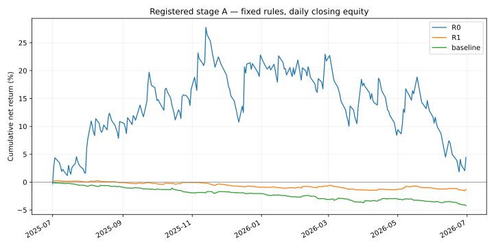

# Registered ORB stage A: complete, effectiveness not established

The fixed R1 implementation lost **1.3038%** in A. The original baseline lost **4.2207%**. R1's relative difference was **+2.9169 percentage points**, but both prespecified paired block intervals include zero. Neither positive profitability nor superior effectiveness is established. No strategy parameters, defaults, source files, or execution permissions changed after exposure.

## Scope and chronology

The immutable [design](../../research/orb-literature/evaluation-design.json), [literature sources](../../research/orb-literature/sources.json), and [actual A registration](../../research/orb-literature/registrations/stage-a.json) distinguish literature rules from project modeling choices. The [bounded exposure recheck](../../research/orb-literature/registrations/stage-a-exposure.json) found no additional recorded A exposure within its stated scope; it cannot certify personal or external knowledge.

- Registration PR [#57](https://github.com/Daxoniel/DX27-Trading-Engine/pull/57) was merged publicly at **2026-10-16 05:39:21 UTC** (07:39:21 Europe/Berlin), commit `4a5eb780bd1d79157969685c6ebab4b842411038`. GitHub content bytes were independently retrieved and matched before capture; the offline registration guard also passed.
- Registration SHA-256: `248cbfe8c3e2befe23cf2364ea3da0edc53b9215458710d8796d558453ba04a3`.
- Historical capture: **05:39:45.164053–05:40:10.532909 UTC**, after publication. Analysis completed at **05:40:39.796922 UTC**.
- Request: June 1, 2025 inclusive through July 1, 2026 exclusive, SIP/raw 1-minute IWM/QQQ/SPY. 694,993 source rows including extended hours. The regular-session guard admitted all 315,450 expected bars across 271 context sessions. June 2025's 20 sessions are warmup only.
- Evaluation: July 1, 2025–June 30, 2026, 251 sessions and 97,350 regular minutes per profile. No dropped days, symbols, substituted feed, partial dataset, retries, or parameter search.
- CSV SHA-256: `250790d6ad8192b38c6b78a4d4fd1caf735dc239feb913c0c752ed960f20687e`; canonical raw archive SHA-256: `3e9dbc24fae3dac7ddd2814e35d4570948a47ae8eeea4bc7e8c73f5b4d30ed54`.

## Fixed profiles and outcomes

R0 is the idealized literature-reference QQQ direction rule, long/short, 1% risk, up to 4x nominal leverage, $25,000 initial capital and zero spread/slippage. R1 is the operational QQQ long-only adaptation with delayed entry, cash and prior-minute volume limits, $100,000 initial capital and modeled friction. Baseline is the unchanged 30-minute IWM/QQQ/SPY breakout with RVOL off and $100,000 initial capital. These bundles differ in multiple ways; their difference cannot identify the causal effect of one rule.

| Metric | R0 reference | R1 primary | Original baseline |
|---|---:|---:|---:|
| Net return | +4.4413% | −1.3038% | −4.2207% |
| Net PnL, USD | +1,110.31 | −1,303.84 | −4,220.71 |
| Minute-end maximum drawdown | 22.3863% | 1.9223% | 4.2207% |
| Closed trades | 251 | 115 | 348 |
| Zero-trade / zero-return days | 0 / 0 | 136 / 136 | 86 / 86 |
| Minute-end nonzero-holdings fraction | 34.4828% | 14.9409% | 13.2111% |
| Ambiguous minutes | 0 | 0 | 0 |
| Reference-price gross PnL, USD | +1,151.00 | −94.98 | −607.12 |
| Commission, USD | 40.69 | 80.50 | 245.19 |
| Spread cost, USD | 0.00 | 564.18 | 1,684.20 |
| Slippage cost, USD | 0.00 | 564.18 | 1,684.20 |

Both R1 and baseline already lose money before modeled costs. Their respective modeled costs are $1,208.87 and $3,613.59. The positive R0 result uses substantially different risk and friction assumptions and is descriptive only; it does not validate a deployable candidate.

## Prespecified uncertainty

Paired circular daily blocks use 10,000 resamples, PCG64 seed 20261015, linear percentile endpoints 2.5% and 97.5%; each block length restarts the RNG. R1 and baseline share indices, compound separately, then subtract. These are project conventions, not literature-derived optimal block lengths or proof of test power. See the fixed design and literature provenance for the methodological basis and limitations.

| Block length | R1 net return interval | R1 minus baseline interval, percentage points |
|---|---:|---:|
| 5 sessions, primary | [−3.4403%, +0.9830%] | [−0.2874, +6.1951] |
| 20 sessions, mandatory sensitivity | [−3.3548%, +0.8248%] | [−0.0169, +5.8298] |

All four intervals include zero. No winner selection, significance claim, or live-trading approval follows.

## Additional friction, fixed fills

Costs below add the same stated basis points to every fill's reference turnover, without resizing or resimulating. R1/baseline already include the design's $0.0035/share commission with $0.35 minimum, 2 bps full spread, and 1 bp directional slippage. These are assumptions, not calibrated Alpaca total fees or historical execution measurements.

| Additional bps per fill | R0 net PnL, USD | R1 net PnL, USD | Baseline net PnL, USD |
|---|---:|---:|---:|
| 0 | +1,110.31 | −1,303.84 | −4,220.71 |
| 1 | −3,887.90 | −1,868.02 | −5,904.91 |
| 2 | −8,886.12 | −2,432.21 | −7,589.11 |
| 5 | −23,880.78 | −4,124.76 | −12,641.71 |

Additional break-even friction is +0.2221 bps for R0, −2.3110 bps for R1, and −2.5061 bps for baseline. Negative values mean the modeled profile is already losing at zero *additional* friction.

## Verification and reproducibility

The unmodified registered runner returned `COMPLETE_REGISTERED_HISTORICAL_ANALYSIS`, with all three profiles and accounting checks complete. It verified actual CSV/raw bytes, publication-before-capture chronology, all 156 source-file seals, Python 3.12 / NumPy 2.3.5 / pandas 2.2.3 / exchange-calendars 4.13.2, and the pinned XNYS calendar. All minute-end marks and daily cash chains were covered, no quality failures remained, and every profile ended flat.

A separate Decimal reconciliation of stored fill cash deltas and closed-trade PnL passed the absolute $0.000001 tolerance; the largest residual was below $0.000000001. This checks stored accounting, not an independent implementation of the trading algorithm. All 22 local artifact hashes were rechecked against the completion seal. No source change required a new implementation regression; PR #56 contains its prior Ubuntu/Windows verification.

- [Full machine-readable report](report.json), including all intervals, arms, daily returns, source/runtime seals and input provenance. SHA-256: `eb0fe643a1fdf59e97d4f6d53119004b9ad3f6a7df8a42f614ff5425ddeb4e59`.
- [Separate reconciliation](validation.json), [local artifact hash manifest](completion.json), [registration publication receipt](registration-receipt.json), and [daily closing equities](daily-equity.csv).
- Raw market records and detailed minute/fill artifacts stay local; this publication contains derived research output. The completion manifest seals local artifacts and does not imply every listed artifact is published.

The provider metadata does not independently authenticate original historical cutoff availability; bars are assumed available at bar end. Minute OHLC, modeled fills, idealized full exits, finite historical scope, chosen cost model, dependent observations and remaining exposure uncertainty limit interpretation. Maximum drawdown here is sampled at minute ends, not continuous intraminute drawdown.

B remains unaccessed. After this complete A report is publicly available, the next step is a fresh B exposure recheck and separate B registration using the same source/runtime and fixed rules, with independent capital restart. A's loss does not suppress B. No paper or live orders were submitted.
