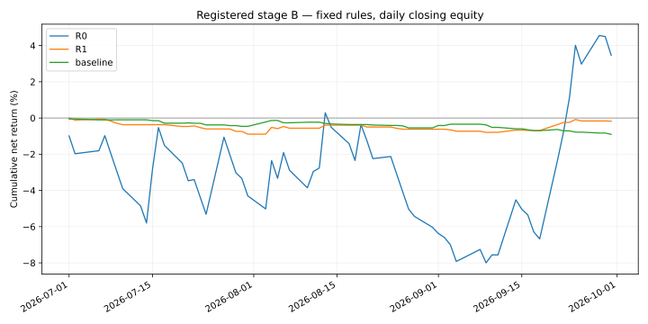

# Registered ORB stage B: complete, effectiveness not established

The fixed R1 implementation lost **0.1759%** in the reserved chronological replication. The unchanged baseline lost **0.9018%**. R1's difference was **+0.7260 percentage points**, but both prespecified paired intervals include zero. Together with A's negative result, this study supplies no demonstrated positive net profitability or reliable superiority for the current operational adaptation. This does not prove that every ORB strategy is unprofitable.

No rules, costs, parameters, source files or execution permissions changed after A or B exposure. A and B remain separately reported; B restarts capital independently and does not replace A as the primary analysis.

## Registration and chronology

The [immutable design](../../research/orb-literature/evaluation-design.json), [literature catalogue](../../research/orb-literature/sources.json), [B registration](../../research/orb-literature/registrations/stage-b.json), and [bounded exposure audit](../../research/orb-literature/registrations/stage-b-exposure.json) specify the rules and limits. B's June warmup overlaps exposed A data; July–September evaluation had no additional recorded historical exposure in the audited scope. Personal, external, deleted or unrecorded exposure cannot be certified absent.

- A's complete report was public in PR [#58](https://github.com/Daxoniel/DX27-Trading-Engine/pull/58), commit `b1bae57da02711bbffaee07c45a41979f11f436b`, at **2026-10-16 05:42:42 UTC** (07:42:42 Europe/Berlin). Its report hash was verified remotely before B capture.
- B registration PR [#59](https://github.com/Daxoniel/DX27-Trading-Engine/pull/59) was merged at **06:29:54 UTC** (08:29:54 Europe/Berlin), commit `a4348591ebe3cfc800ac9079aae1cedf96cdf34a`.
- B registration SHA-256: `474c5959ca3f8151661bcbe924e3d908445da310ae8f758264538fb29848a8ea`. GitHub content bytes and both server publication timestamps were independently verified, then the unchanged B guard passed before capture.
- Capture: **06:30:25.003033–06:30:33.794309 UTC**; analysis completed **06:30:45.208686 UTC**, all after both publication gates.
- Request: June 1–October 1, 2026, end exclusive, SIP/raw IWM/QQQ/SPY minute bars. 219,582 source rows including extended hours; all 99,450 expected regular bars across 85 context sessions passed the source guard. June's 21 sessions are warmup only.
- Evaluation: July 1–September 30, 2026, **64 sessions and 24,960 regular minutes per profile**. No missing days or symbols were removed, no feed substituted, no retries or parameter search occurred.
- CSV SHA-256: `4cc2469a1387ba1ba3cf0bbd5c153a6d3d1b2d38c7b0800ab8b1b782695ceadd`.
- Canonical raw archive SHA-256: `8d8f07e37b68c2142bafe17deced3f0f913db4ac80a23cd9e3ed2f15f2cd4e27`.

## Complete fixed-profile outcomes

R0 is the idealized QQQ long/short reference: 1% risk, up to 4x nominal leverage, $25,000 initial capital, and zero spread/slippage. R1 is the QQQ long-only operational adaptation with delayed entry, cash and prior-minute volume limits, modeled friction and $100,000 initial capital. Baseline is the original 30-minute IWM/QQQ/SPY breakout, RVOL off, with $100,000 initial capital. These bundles differ in several dimensions; this comparison cannot isolate one causal rule effect.

| Metric | R0 reference | R1 primary | Original baseline |
|---|---:|---:|---:|
| Net return | +3.4613% | −0.1759% | −0.9018% |
| Net PnL, USD | +865.34 | −175.87 | −901.82 |
| Minute-end maximum drawdown | 10.0173% | 1.0477% | 0.9287% |
| Closed trades | 63 | 30 | 65 |
| Zero-trade / zero-return days | 1 / 1 | 34 / 34 | 30 / 30 |
| Minute-end nonzero-holdings fraction | 37.1514% | 16.7388% | 9.7917% |
| Ambiguous minutes | 0 | 0 | 0 |
| Reference-price gross PnL, USD | +872.28 | +139.24 | −217.16 |
| Commission, USD | 6.95 | 21.00 | 45.50 |
| Spread cost, USD | 0.00 | 147.05 | 319.58 |
| Slippage cost, USD | 0.00 | 147.05 | 319.58 |

B's R1 reference-price gross profit was $139.24 and modeled costs were $315.11, leaving −$175.87 net. A's R1 gross PnL was already negative (−$94.98). Therefore, this evidence does not establish a robust pre-cost edge or justify treating fees as the sole problem. The decomposition uses the same recorded fills, not a separately resimulated zero-cost strategy.

## Prespecified uncertainty

Paired circular daily block resampling: 10,000 samples, PCG64 seed 20261015, linear 2.5%/97.5% percentiles; RNG reinitialized for each stage/block length. R1 and baseline share resampled indices, compound separately and then subtract. Block lengths and other finite-sample choices are fixed project conventions, not literature-proven optimal values or proof of power. Sixty-four sessions and 30 R1 trades provide limited evidence; no trade-iid inference or significance claim is made.

| Block length | R1 net return interval | R1 minus baseline interval, percentage points |
|---|---:|---:|
| 5 sessions, primary | [−1.5579%, +1.3512%] | [−0.9114, +2.4265] |
| 20 sessions, mandatory sensitivity | [−1.4783%, +1.0540%] | [−0.6508, +2.2992] |

All four intervals include zero. Positive differences in both A and B do not establish superiority, and losing less than the baseline does not establish profitability.

## Fixed-fill additional-friction sensitivity

R1/baseline already include the fixed $0.0035/share commission with $0.35 minimum per fill, 2 bps full spread and 1 bp directional slippage. These are modeling assumptions, not calibrated Alpaca historical execution costs or a complete actual fee schedule. The cases add the stated bps to every fill's reference turnover without resizing or resimulation.

| Additional bps per fill | R0 net PnL, USD | R1 net PnL, USD | Baseline net PnL, USD |
|---|---:|---:|---:|
| 0 | +865.34 | −175.87 | −901.82 |
| 1 | −128.14 | −322.92 | −1,221.39 |
| 2 | −1,121.61 | −469.97 | −1,540.97 |
| 5 | −4,102.03 | −911.14 | −2,499.70 |

Additional break-even friction: R0 +0.8710 bps, R1 −1.1959 bps, baseline −2.8219 bps. Negative values mean losses already exist at zero additional friction. Even R0's idealized profit turns negative with 1 bp of additional friction per fill in both A and B. R0 is descriptive, not a selected replacement candidate.

## Verification and artifacts

The unchanged runner returned `COMPLETE_REGISTERED_HISTORICAL_ANALYSIS`. Input bytes, publication chronology, all 156 source seals, the identical A/B runtime and pinned XNYS calendars passed. Each profile has all 64 daily records, all 24,960 minute-end marks, continuous daily capital and no remaining quality failures or open positions.

Separate Decimal sums of recorded fill cash deltas and trade PnL agree within absolute $0.000001; the largest residual is below $0.000000001. All 22 local artifact hashes match the completion manifest. This is an accounting cross-check, not an independently implemented trading model or authenticated provider audit. No implementation changes required additional regression; implementation verification remains documented in PR #56.

- [Full report](report.json), including every arm, interval, daily return, source/runtime seal and input provenance. SHA-256: `d675aa4ffded773ee9da240cc86e4a1fa22406d6e9b8aa0688441899f5f7abed`.
- [Reconciliation](validation.json), [local completion manifest](completion.json), [publication receipts](registration-receipt.json), [daily equities](daily-equity.csv).
- [Complete A report](../orb-stage-a/README.md).

Raw quotes and detailed minute/fill artifacts stay local; published artifacts are derived research output. The manifest seals local files and does not imply every listed file is published. Historical bars do not establish original-cutoff availability; availability is assumed at bar end. OHLC resolution, idealized complete exits, modeled costs, finite scope and remaining exposure uncertainty limit interpretation. Drawdown is measured at minute ends, not continuously.

## Research decision after A and B

Keep broker submissions disabled and do not promote R1 or select R0 based on the observed results. The fixed A/B evaluation is complete; both periods are now exposed and may only support exploratory diagnosis, not a new claim of untouched validation. There is no additional unexposed sample promised by this study.

The next useful work is a literature-linked research review, before any new candidate tuning: map each paper rule to the implemented reference and operational adaptations; distinguish account constraints, directional restrictions, entry timing, stops and friction assumptions. The ETF paper's favorable idealized results do not automatically transfer to the long-only cash-limited adaptation. The stocks-in-play paper studies a different universe and selection process; its high reported Sharpe does not validate this ETF strategy. See the existing source catalogue for exact provenance and evidence levels.

An exploratory attribution study on exposed A/B data could then be separately specified with a small, explicit set of contrasts, all attempts reported and transaction costs retained. Those contrasts would be new hypotheses, not conclusions already established here. No threshold, parameter range, trained model or new acceptance gate is invented in this report. Any later confirmatory claim requires a genuinely new, predeclared evaluation period or a prospective protocol, not recycling A/B, reducing modeled costs to produce profit, or reporting the best explored variant as independent evidence. The framework and provenance work remain reusable even though this candidate has not demonstrated profitability.
