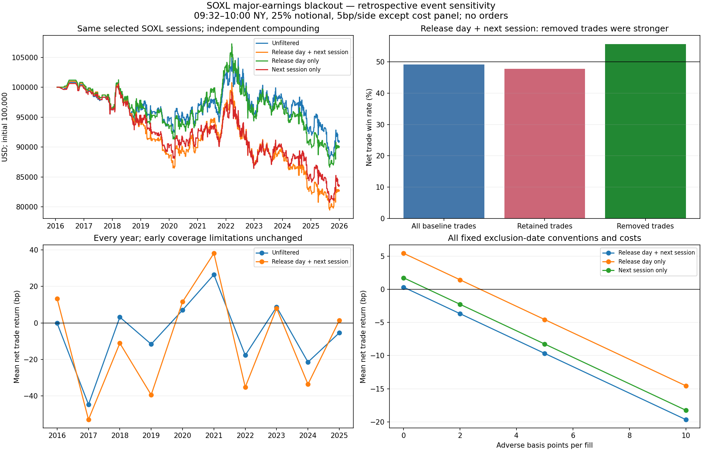

# SOXL：避开 SOXX 重仓股财报日的对照测试

结论：**这项过滤没有改善原策略的净收益，也没有建立高胜率优势。**
仅跳过公告日，胜率略升但平均每笔收益与净值更差；保守地同时跳过下一
交易日，胜率、平均收益和回撤均变差。这个结果不意味着财报交易普遍
更好，只说明在这一套固定 SOXL 早盘反转规则与样本里，剔除的交易相对较好。

## 只改变这一项过滤

原规则保持不变：SOXL 隔夜低开才做多，纽约时间 09:32 分钟开盘价入场、
10:00 分钟开盘价离场；初始 $100,000，每笔 25% 当前净值名义金额，现金
利息零，不补仓、不加止损止盈。主成本仍为买卖各 5bp 不利价格情景，
不是券商实际收费或实测报价成本。

用户提出“重大财报日不交易”，本轮在计算前将“重大”固定为**当时最近
已公开的 SOXX 持仓快照中，按股票持仓价值排名前五的发行人**。不使用
今天的成分股回填过去，也不按事后股价波动大小挑选事件。

协议先公开于 `41e6efa`；49 份历史持仓快照、205 项已核实业绩事件在
`e561612` 封存并核对公开字节，之后才计算本次过滤收益。
[协议](../../research/soxl-earnings/protocol.json)与[输入审计](../../research/soxl-earnings/input-audit.json)
保留全部约定。本轮是已暴露历史数据上的探索，不是独立样本外检验。

日期定义也在事前固定，全部报告：

1. **公告当天**：只剔除实际公告的纽约日历日期，若当天是交易日。
2. **公告当天及下一交易日，预定主测试**：覆盖盘后财报影响，缺乏可靠
   发布时间时不猜盘前盘后。下一交易日按交易所日历，不是日历日加一。
3. **只剔除下一交易日**：作为同一过滤规则的日期敏感性。

财报公布时先确定是否属于重仓股，再将该事件的排除日期固定；不在
次日根据新持仓或价格表现重新判断。重叠财报按日期去重。

## 相同样本与成本的结果

| 09:32–10:00，买卖各 5bp | 低开做多交易数 | 扣费后胜率 | 平均每笔收益 | 盈利因子 | 样本净值最大回撤 |
|---|---:|---:|---:|---:|---:|
| 原策略，不过滤 | 885 | 49.15% | −3.64bp | 0.958 | 16.08% |
| 只跳过公告当天 | 805 | 49.32% | −4.57bp | 0.948 | 19.23% |
| **跳过当天及下一交易日** | **734** | **47.82%** | **−9.68bp** | **0.893** | **21.33%** |
| 只跳过下一交易日 | 805 | 48.07% | −8.26bp | 0.908 | 19.76% |

1bp = 0.01%。每笔收益以该笔标的名义金额为分母；回撤是交易结束时的
账户净值回撤，不是盘中最大回撤。相同成本下，原策略样本终值 $90,980.99，
仅剔除当天 $90,070.25，当天及次日 $82,753.62，只剔除次日 $83,597.50。
每组独立复利，未从旧终值简单减去被移除交易的旧美元盈亏。

主测试在原 2,016 个有效交易日中设置 322 日不交易，实际移除 151 笔低开
做多交易。这 151 笔原本胜率为 **55.63%**，平均每笔 **+25.69bp**，盈利
因子 1.362。保留下来的 734 笔反而更弱。只剔除下一交易日移除的 80 笔
原本胜率为 60.00%，均值 +42.85bp；不能把这两个事后子样本直接升级为
“专做财报日”的新策略。

原策略最差单笔 −7.251% 在三个过滤口径下都仍存在。减少财报暴露没有
消除这个尾部损失，且本样本的净值回撤反而增加。

## 年份、成本与不确定性

原入场、退出和成本保持不变，下面比较预定主测试的全部年份：

| 年份 | 原交易数 | 过滤后交易数 | 原胜率 → 过滤后 | 原均值 → 过滤后，bp/笔 |
|---|---:|---:|---:|---:|
| 2016 | 9 | 6 | 44.44% → 50.00% | −0.16 → +13.28 |
| 2017 | 34 | 28 | 38.24% → 32.14% | −44.72 → −52.98 |
| 2018 | 93 | 78 | 50.54% → 47.44% | +3.15 → −11.11 |
| 2019 | 85 | 68 | 44.71% → 41.18% | −11.65 → −39.43 |
| 2020 | 84 | 71 | 46.43% → 46.48% | +7.00 → +11.55 |
| 2021 | 103 | 84 | 59.22% → 60.71% | +26.43 → +38.13 |
| 2022 | 141 | 119 | 48.23% → 46.22% | −17.75 → −35.16 |
| 2023 | 120 | 102 | 50.83% → 50.00% | +8.74 → +7.96 |
| 2024 | 105 | 87 | 48.57% → 47.13% | −21.49 → −33.62 |
| 2025 | 111 | 91 | 47.75% → 47.25% | −5.43 → +1.37 |

覆盖完整的 2024–2025 年，过滤后合计 178 笔，胜率 **47.19%**，均值
**−15.74bp**；原来是 216 笔、48.15%、−13.24bp。不能只挑 2021 或 2025
某个较好的结果。早期原始分钟线不足的限制完全沿用，未因增加过滤而消失。

| 每边成本 | 原策略均值 | 仅当天 | 当天及次日 | 仅次日 |
|---|---:|---:|---:|---:|
| 0bp | +6.36 | +5.43 | +0.32 | +1.73 |
| 2bp | +2.36 | +1.43 | −3.68 | −2.27 |
| 5bp | −3.64 | −4.57 | −9.68 | −8.26 |
| 10bp | −13.63 | −14.56 | −19.66 | −18.25 |

单位均为每笔 bp；零成本下的均值也下降，不能把变化全部归咎于费率。
所有四个原方向臂、四个成本情景均保留，另附原 09:31 乐观价格代理的
敏感性，没有把它事后改成主策略或声称可成交。

主测试采用同一 2,016 日配对循环块重抽样，20 日块、2,000 次固定种子：

- 过滤后胜率 95% 区间：44.51%–51.15%。
- 过滤后平均每笔收益区间：−23.39bp 至 +4.23bp。
- 相比原策略的平均账户日收益变化区间：−1.17bp 至 +0.16bp。

该差异区间包含零，不能宣称过滤一定有害；当前历史观察是更差，且没有
高胜率或净收益改善证据。日期敏感性相互重叠，不是独立重复实验；没有
把其中一个显著性结果当成未来概率。

## 持仓与事件是怎样核验的

SOXX 身份固定为 SEC CIK `1100663`、series `S000004354`、class `C000012084`。
使用 NPORT-P 与更早的 N-Q、N-CSR/N-CSRS 投资明细，股票按报告价值排名。
快照只有在 SEC 提交日期之后的交易日才可使用；较晚提交的旧期修订，
不会覆盖已经公开的较新持仓期。历史 Avago/Broadcom 法人沿革单独处理，
并未将被收购前的 Broadcom Corp. 与 Avago 误当同一家公司。

49 份快照中，48 份通过通用提取与股票价值合计核对；2018-06-30 那份因
旧 HTML 排版未通过通用解析，另对原报告第 209 页五个持仓值和合计逐项
核对，保留来源哈希与标记。该修正没有改变选中的财报事件名单。
全部 2,514 个目标交易日均有之前已公开的快照，但持仓时点滞后 **55–239 天**。
这是一套可解释的“最近公开重仓股”定义，**不等于精确的当日成分与权重**。

203 份美国公司 Item 2.02 候选文件逐项核对实际公告段落；13 份候选的
SEC reportDate 与实际公告日不同，已更正，不能直接把文件日期当财报日。
其中两份仅涉及未来指引，未作为季度业绩发布纳入。最终包括 201 项美国
业绩发布，以及 TSM 三份公司季度业绩原始 PDF、NXP 一份公司原始公告。
实际已结束季度的两项初步业绩发布纳入；未来指引更新未纳入。

十年内被选为重大事件的发行人及事件数：AVGO 40、NVDA 38、QCOM 37、
TXN 36、INTC 32、AMD 16、TSM 3、NXPI 1、AMAT 1、MU 1。名单会变化，
例如早期 TSM、NXP 与后来的 AMD，不能用今天五家公司代替。

[事件表](../../research/soxl-earnings/events.json)逐条附公告日期、原始链接与
哈希；[历史快照](../../research/soxl-earnings/holdings-snapshots.json)、
[日期更正](../../research/soxl-earnings/date-corrections.json)及
[拒绝的非业绩事件](../../research/soxl-earnings/rejected-non-results.json)均公开。
原始大文件与授权 SOXL 分钟线留在本地 work/。

**实盘适用边界：**这次核验的是实际历史事件日，尚未逐条取得当时事前
公布的财报排期存档。尤其不能因为事后知道一次临时初步业绩发布，就假装
当天早晨提前知道。因此结果属于事件条件敏感性，不是完整的事前财报日历
执行证明；下一交易日口径也仍缺报价、到达与成交证据。没有新增 Paper
或真实订单，没有部署此过滤规则。

## 验证与复现

全部 16 个原主时点基准与四个原 09:31 基准逐字段精确匹配；在保留所有
原有效交易日的账本上，将过滤日设为零仓位、零交易收益，重新递推净值。
原有 498 个缺失交易日的事后样本筛选问题继续适用。

- [完整结果](report.json)：48 个过滤情景、全部日期、事件归属、年份和区间。
- [独立复算](independent-validation.json)：506 项检查，独立重建日期、
  48 情景、保留/移除交易均值分解，并核验 205 份事件与 49 份持仓原始哈希。
- [验证记录](validation.json)：157 项离线测试；原 156 个生产源文件哈希不变。
- [协议与输入先公开证据](protocol-publication.json)。全部旧结果保持原样。

```sh
python research/orb-diagnostics/check_soxl_earnings.py --sessions work/soxl-reversal/attempt-3/sessions.json --output work/soxl-earnings/new-run
PYTHONPATH=src python -m unittest discover -s research/orb-diagnostics -p 'test_*.py'
```

需要上一轮精确哈希的私有 SOXL 分钟派生文件，以及项目指定的
exchange-calendars 4.13.2；图表另需可选 matplotlib。


