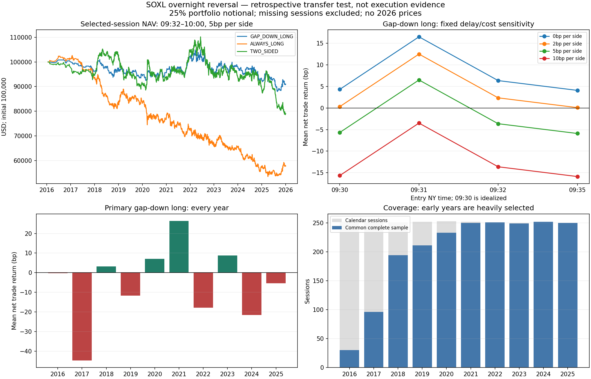

# SOXL：隔夜低开后的早盘反转研究

结论：**这次固定规则检验没有找到 SOXL 的高胜率优势，也不足以进入
Paper 策略交易。** 它否定的是未经筛选的简单低开买入方案，不是所有
SOXL 策略，更不能据此否定原论文在其他标的和报价数据上的结果。

## 研究规则与证据

依据用户上传的 Iwanaga 与 Sakemoto 工作论文，先公开固定
[协议](../../research/soxl-reversal/protocol.json)，再下载完整数据、计算收益。
协议提交：`6fe48f181de7de6c59e7dc33aa62081b8b7cd5ec`。

- 样本目标：2016–2025 年 SOXL；**没有请求纽约交易日为 2026 年的价格**。
- 信号：09:30 分钟开盘价低于前一交易日最后常规交易分钟的收盘价。
- 主测试：09:32 分钟开盘价买入，10:00 分钟开盘价卖出。
- 初始资金 100,000 美元，每笔使用当前净值 25% 名义金额，现金利息零。
- 主成本：买卖各施加 5bp 不利价格；不是 Alpaca 实际收费或实测滑点。
- 不设止损、止盈，不加仓。它们不属于论文这一简单规则，本轮没有优化。
- 另报每日做多、隔夜高开做空、双向反转，以及所有预定延迟和成本情景。
  做空结果没有借券、定位或融券成本证明，只作诊断。

原论文使用 LSEG 中间报价，主样本是 SPY，未检验 SOXL。本研究使用
Alpaca SIP 拆股调整分钟成交价；前收盘是最后一分钟收盘代理，**不包括
恰好标记在交易时段结束的收盘竞价成交**。因此这不是原论文精确复现。

## 主结果

| 09:32–10:00；买卖各 5bp | 交易数 | 扣费后胜率 | 平均每笔收益 | 盈利因子 |
|---|---:|---:|---:|---:|
| 隔夜低开做多，主测试 | 885 | 49.15% | −3.64bp | 0.958 |
| 每天做多，基准 | 2,016 | 47.82% | −10.32bp | 0.880 |
| 隔夜高开做空，诊断 | 1,131 | 48.72% | −4.44bp | 0.944 |
| 隔夜反向双向交易，诊断 | 2,016 | 48.91% | −4.09bp | 0.950 |

1bp = 0.01%。表中每笔收益是该笔标的名义金额的收益，不是整个账户收益。

主测试平均盈利单 +1.698%，平均亏损单 −1.713%，没有用大盈亏比弥补
胜率。最差单笔 −7.251%，最长连续亏损 6 笔。25% 仓位的样本选择账户
终值为 $90,980.99，交易结束时净值最大回撤 16.08%；这**不是盘中最大回撤**。
最不利盘中标的浮动 −9.180%，未计额外盘中交易成本。

按 20 个有效交易日的配对循环块、2,000 次固定种子重抽样：

- 扣费后胜率 95% 区间：46.17%–52.11%。
- 平均每笔净收益 95% 区间：−17.21bp 至 +9.12bp。
- 相比每天做多的平均账户日收益差区间为 +0.50bp 至 +3.98bp。
  **亏得较少不等于具有正期望收益。**

隔夜涨跌与 09:30–10:00 收益回归：beta = −0.02840，HAC(5) t = −1.375，
R² = 0.198%。三个固定时间分段的斜率也没有强统计证据。回归负号本身
不足以证明可交易优势，机制解释也不是因果识别。

## 时间与成本为何重要

所有行使用同一批 885 笔低开交易日期；没有从结果中挑选最佳入场时间。

| 入场代理 | 零成本平均每笔 | 买卖各 2bp | 买卖各 5bp | 买卖各 10bp |
|---|---:|---:|---:|---:|
| 09:30，同价信号理想化 | +4.33bp | +0.33bp | −5.67bp | −15.66bp |
| 09:31，乐观边界 | +16.51bp | +12.51bp | +6.50bp | −3.50bp |
| **09:32，主测试** | **+6.36bp** | **+2.36bp** | **−3.64bp** | **−13.63bp** |
| 09:35，额外延迟 | +4.09bp | +0.09bp | −5.91bp | −15.90bp |

主测试零成本胜率也只有 50.73%，所以问题不只是成本设得较高。
主测试均值的盈亏平衡成本约为**单边 3.18bp**，还未扣独立佣金等费用。
09:31 的正数值得保留记录，但不能事后替换预定主测试：分钟首笔成交价
不证明计算完成并发单后仍能成交，必须另用报价和到达时刻证据检验。
反过来，09:32 不赚钱也不能证明更早的实际执行一定不赚钱。

## 数据覆盖与近年复核

共下载 154 页、1,534,908 根 SIP 分钟线。目标 2,514 个交易日，要求
09:30–10:00 每分钟以及前一交易日最后一分钟都完整后，保留 2,016 日。
**排除 498 日，覆盖率 80.19%；排除规则包含事后可知的分钟完整性，
属于样本质量筛选，不能假装成实时可执行过滤条件。**

| 年份 | 有效日 / 应有日 | 主测试交易数 | 胜率 | 平均每笔净收益 |
|---|---:|---:|---:|---:|
| 2016 | 30 / 252 | 9 | 44.44% | −0.16bp |
| 2017 | 96 / 251 | 34 | 38.24% | −44.72bp |
| 2018 | 194 / 251 | 93 | 50.54% | +3.15bp |
| 2019 | 211 / 252 | 85 | 44.71% | −11.65bp |
| 2020 | 233 / 253 | 84 | 46.43% | +7.00bp |
| 2021 | 250 / 252 | 103 | 59.22% | +26.43bp |
| 2022 | 251 / 251 | 141 | 48.23% | −17.75bp |
| 2023 | 249 / 250 | 120 | 50.83% | +8.74bp |
| 2024 | 252 / 252 | 105 | 48.57% | −21.49bp |
| 2025 | 250 / 250 | 111 | 47.75% | −5.43bp |

早期覆盖尤其不足，不能声称完整十年复现。2024–2025 覆盖完整，
216 笔交易胜率仍仅 48.15%，平均每笔 −13.24bp。2021 年较好的结果
没有在后续年份稳定延续。EARLY/MIDDLE/LATE 是历史稳健性分段，
不是新的独立样本外确认。

完整报告同时给出有效日年化和日历时间 CAGR；二者不能混用。净值曲线
默认被排除日期没有交易，仅表达所选观察样本的复利，不证明实际账户轨迹。

Yahoo 日线与 SIP 代理的隔夜方向有 18 日不一致，48 日隔夜幅度差超过
50bp；不能把不同来源或收盘定义当作相同价格。报告另以 Yahoo 日线方向
替换信号、保持 SIP 日内成交代理进行数据质量敏感性检验。
该敏感性为 889 笔、胜率 48.82%、均值 −4.90bp，仍不支持高胜率优势。
排除除息日后，主测试 873 笔，胜率 49.37%，均值 −3.22bp，结论没有改善。

## 对下一步的约束

本轮没有验证“跌越多越容易反弹”：固定低开超过 3% 桶胜率 49.22%，
均值 −4.54bp。高波动描述分组略好，但用的是全样本中位数，不能用于
历史入场，也不是独立发现或高胜率证明。所有桶和亏损结果都保留。

SOXL 每日三倍目标不会自动创造方向胜率。当前证据不足以把“低开”
单独用作买入信号。若继续，应另立一个机制明确的候选，例如可编码的
强势背景、回调失效与重新转强；或者检验更早入场的真实报价成本。
它们都属于新假设，不是这篇论文已证明的结论。已查看的 2016–2025
数据之后均应按开发数据处理；2026 年目前仍未用于本研究。

## 审计与复现

- [完整结果](report.json)：64 个固定情景、年份、分段、所有排除日期和来源差异。
- [独立复算](independent-validation.json)：363 项检查，包括全部 64 情景、
  独立 NumPy 最小二乘与矩阵 Newey–West、源文件哈希和保留年份检查。
- [来源与限制](sources.json)、[协议先公开证据](protocol-publication.json)、
  [验证记录](validation.json)。原始授权数据与逐分钟轨迹仅存本地 work/，没有公开转载。
- 本轮 148 项离线测试；原 156 个 src/dx27 文件保持原哈希。Paper 和实盘订单均为 0。

复现（需相同版本与有权限的本地源数据；数据是当前修订版本）：

```sh
python research/orb-diagnostics/fetch_soxl_history.py --output work/soxl-source-new
python research/orb-diagnostics/check_soxl_reversal.py --source work/soxl-source-new --secondary work/soxl-reversal/yahoo-source.raw --output work/soxl-run-new
PYTHONPATH=src python -m unittest discover -s research/orb-diagnostics -p 'test_*.py'
```

精确复算须使用 sources.json 记录的原始源文件哈希。重新请求得到的
修订数据不保证逐字节一致。分析环境依赖项目声明的 exchange-calendars
4.13.2；图表另外使用可选 matplotlib，离线测试不依赖它。


