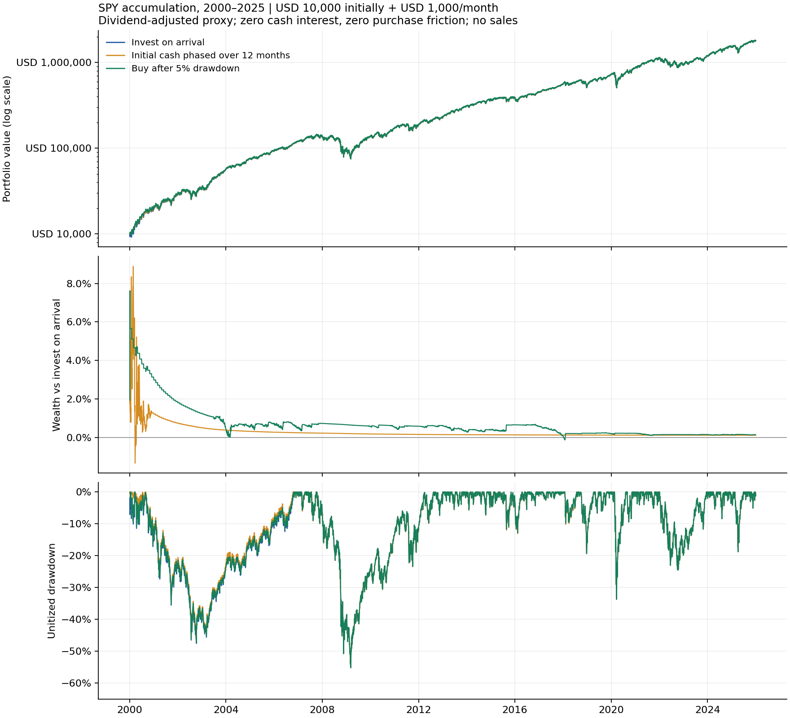

# SPY长期积累：到账即买、分批定投与回撤5%买入

2026-10-19。按用户“试试”实施历史比较，未发Paper或实盘订单。**长期持有在此样本积累了显著资产，但5%买跌规则没有表现出稳定的额外优势，也没有显著降低长期持仓的回撤。**

## 固定规则与相同资金

三组均从2000年首个交易日开始，初始10000美元；之后从2月起，每月首个SPY交易日开盘再投入1000美元，至2025年底。累计投入321000美元，不预支未来入金，不借款、不卖出。三个版本：

1. **到账即买**：初始资金及每笔新增资金到达即投入。
2. **首笔分12个月定投**：仅把初始10000美元分12个月投入，后续月供仍到账即投入；第12个月将剩余现金和利息全部投入。此后与第一组的月供安排相同，不能把差异泛化为所有定投方法。
3. **5%回撤买入**：每日收盘，和该日前252个交易日最高收盘价比较，回撤至少5%时，下一交易日开盘买入全部可用现金。昨日信号可用于当日新到账的月供；不足触发条件就继续持有现金。已买持仓始终保留。

5%、252日和12个月是事先固定的项目情景，不是文献最优值；本轮不搜索其他阈值。[规则与来源哈希](../../research/spy-long-hold/protocol.json)及代码在提交`6efc3e0bb2cd2f204d1aa84229f7930f422cc8a2`公开核验后计算结果，但原始公共历史数据已经取得，不能称新样本预注册或独立确认。

## 2000—2025年主结果

以下是现金零利息、购买摩擦为零、未计税的情景；分红采用复权总回报近似再投，不是精确券商DRIP。期末只是按收盘价估值，不强制卖出。

|指标|到账即买|首笔分12个月|5%回撤买入|
|---|---:|---:|---:|
|累计投入，美元|321000|321000|321000|
|期末资产，美元|1794983.02|1796958.35|1797512.55|
|相对到账即买的期末差额，美元|—|+1975.33|+2529.53|
|单位化收盘权益最大回撤|55.19%|55.19%|55.16%|
|平均闲置现金占总资产|0.00%|1.36%|0.94%|
|实际买入交易日数|312|312|167|
|资金加权年化XIRR|11.1112%|11.1177%|11.1195%|
|时间加权年化回报|7.9480%|8.0678%|8.1989%|

买跌组26年后只比到账即买多约0.14%的期末资产。它的买入次数较少，但资金投入后一直持仓，因此2008年一类大跌仍作用于已有仓位；等待未来买点并不保护已投资资产。收盘回撤未覆盖日内最差价格。资金加权回报受每笔入金时机影响，和时间加权回报不是同一指标，不能拿较高的XIRR当固定预期收益。



图上方为含外部入金的总资产，采用对数轴；中间为相对到账即买的资产差；下方用剔除入金影响的单位化权益计算回撤。不能用持续入金把账面总额抬高后宣称回撤被消除。

## 现金利息、购买摩擦和起点检验

闲置现金按滞后三个月美债收益率代理计息后，三组期末资产分别约1794983.02、1799187.85、1801361.21美元；买跌组领先约0.36%。这只是代理情景，不能认证Alpaca或任何实际账户能获得同样利息；收益率序列也不等于持有国债的真实总回报。

另将每次买入成本统一提高到购买本金5bps：零现金利息时，期末分别为1794085.98、1796060.32、1796614.74美元。未观察到该成本情景改变主要判断；没有从结果反推更低的实际费用。

为避免只看2000年一个起点，还完整计算了2000—2009、2001—2010，直到2016—2025的17个十年窗口；每个窗口均独立重置相同资金安排，信号用窗口开始前的实际252日历史，不重置成不存在的价格高点。

|零买入摩擦的窗口比较|现金零利息|美债利率代理|
|---|---:|---:|
|买跌组期末资产超过到账即买|8/17|9/17|
|买跌组期末资产超过分批定投|8/17|9/17|
|相对到账即买的最差/最好期末差异|−2.50% / +0.76%|−2.19% / +0.88%|

这些窗口重叠，并非17份独立证据；胜出数不是统计显著性或未来胜率估计。所有窗口、四种现金/成本组合及三组指标完整保存在[机器报告](report.json)，未删掉不利起点。

## 数据与计算边界

- Yahoo Finance提供1998—2025年7043个SPY交易日，覆盖1998年以来热身及2000—2025年6539个评价交易日；日期与固定XNYS日历逐项一致，日线没有缺失，来源返回113条分红事件、0条拆股事件。原始字节留本地，公开其哈希。
- SPY信号使用未做分红调整的收盘价；投资回报使用`adjclose`及`open * adjclose / close`的复权开盘近似。没有再把现金分红加到账上，避免重复计入。复权序列采用当前版本，可能修订，也不能恢复精确分红支付日、税款和DRIP成交价；这里只模拟含分红的回报代理。
- 复权单位不是实际持有股数。允许分数单位、按日线开盘成交，无订单队列或部分成交模拟。整体复权倍数变化不改变模拟资产，已用构造测试核验；未来调整不能作为价格信号。
- FRED DGS3MO有效观测7003条，按年化百分比转比例、ACT/365简单日计息。每个计息区间只用严格早于上一SPY交易日的最后观测，滞后一交易日并拒绝超过14天的数据缺口。数据为当前版本，未认证历史发布时间或修订前值，故只作现金利率敏感性代理；零利息情景始终单列。
- 三组都只买不卖，成本只计购买摩擦情景；未计税、汇率和通胀，也未认证真实账户适用交易费用。不将此长期股票敞口的结果直接归因为优于低敞口日内策略。

[来源、抓取哈希及依据](sources.json)包含Yahoo复权口径、FRED官方序列和SPY发行人说明。初次FRED URL返回HTML，已排除；实际使用明确CSV schema的数据，没有把网页当利率表。

## 验证与下一步判断

本地123项诊断检查通过，其中13项新增覆盖回撤边界、昨日信号/次日开盘、相同入金、资金单位化、滞后利率、费用预算、分红不重复计入和复权缩放不变性。完整来源哈希、日历覆盖、三组现金流和12份主情景日账本校验通过。另用独立逐笔投入求和重建到账即买的期末资产，并用总回报价格比核验该组TWR，均一致，见[独立核验](independent-validation.json)。原156个`src/dx27`文件未改。

目前支持把简单长期积累作为重要基准，**不支持把“5%必然更好”或“只买不卖回撤很小”当结论**。后续若做Paper长期试运行，应保持小规模并明确分红/利息记账限制；短期Paper结果无法验证26年复利表现。本轮没有启动自动买入，也没有将长期历史收益当未来承诺。

复查命令（输出目录必须尚不存在，原始数据保留本地）：

```bash
PYTHONPATH=src python research/orb-diagnostics/check_spy_accumulation.py \
  --spy work/spy-long-hold/spy-source.raw --cash work/spy-long-hold/cash-source.csv \
  --output work/spy-long-hold/recheck
```

[方案公开记录](protocol-publication.json)、[验证封存](validation.json)。
