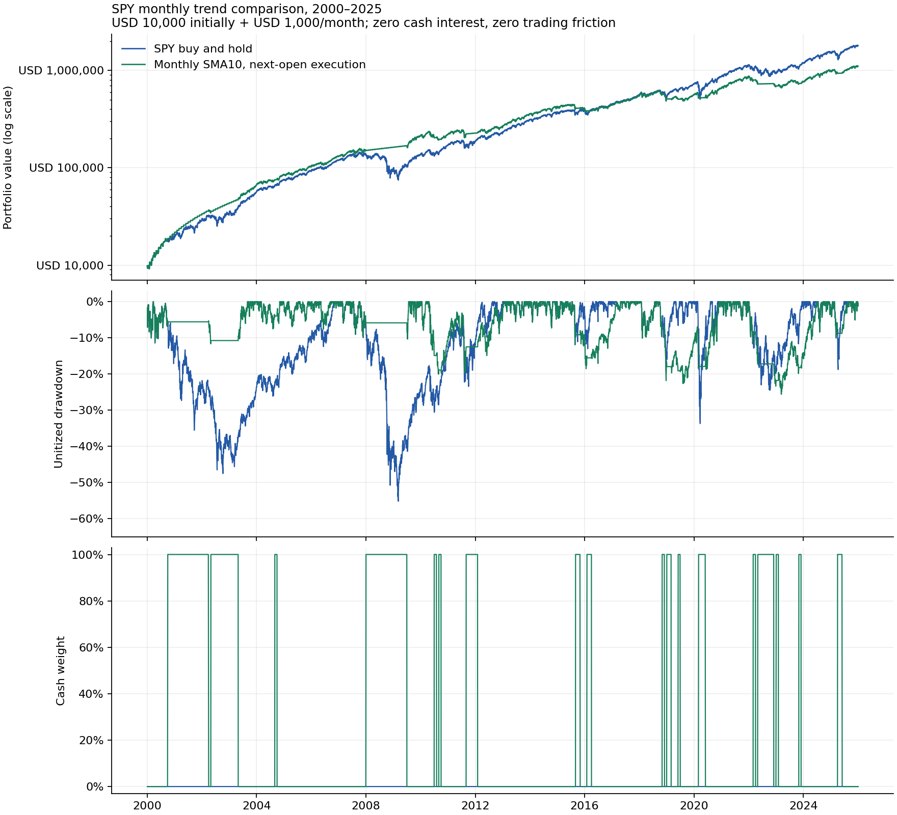

# SPY月度10个月均线：风险下降与收益代价

2026-10-20。按用户同意的固定版本，与SPY到账即买长期持有比较。**本样本的总体回撤和最长恢复时间下降，但期末资产明显减少，不能称为全面优于持有。** 未向Paper或实盘发单，也未按结果修改均线长度。

## 文献与实现约定

已从作者网站取得Faber的70页[A Quantitative Approach to Tactical Asset Allocation](https://mebfaber.com/wp-content/uploads/2016/05/SSRN-id962461.pdf)，首页列明2013年2月更新。PDF pp.21–22核对了月度10个月SMA、含分红数据、90日国债现金，以及信号日收盘成交等假设；文件哈希、版本与核查范围见[sources.json](sources.json)。没有独立复算作者GFD原始数据，不认证SSRN与作者站点字节相同。

本轮固定规则为：月末含分红复权收盘价大于最近10个月月末复权收盘均值时持有SPY，低于时持现金；均值包含信号当月。相等时保留此前目标方向，是项目补充约定。只在月末更新，月中不因跌破均线交易。**信号在收盘后才可用，下一交易日开盘执行**，不同于原文的信号日收盘假设。此为SPY单资产迁移，不是论文多资产配置的等价复现。

两组均从2000年首个交易日开始，初始10000美元，之后每月首个SPY交易日到账1000美元，至2025年底累计321000美元。空仓时月供留现金，有效多头月份再投入；无卖空、无杠杆，允许复权分数单位。每个独立窗口的初始目标来自开始前已完成月末信号，资金则重新起始。1998—1999年数据提供月度热身。

[规则及来源封存](../../research/spy-trend/protocol.json)与源码在`c64cca2761666073f335018f68cbddc350bb02fb`公开核验后执行，见[记录](publication-before-run.json)。同一2000—2025价格和持有结果已在上一轮看过，所以本轮是探索，不能称新样本外确认。

## 主结果：同样累计投入32.1万美元

主表为现金零利息、零交易摩擦、未计税的情景；分红使用Yahoo复权开收盘的总回报近似，并非精确支付日DRIP。

|指标|长期持有|10个月趋势过滤|
|---|---:|---:|
|期末模拟资产，美元|1794983.02|1104092.87|
|单位化收盘权益最大回撤|55.19%|25.63%|
|最长已完成峰值恢复期，日历天|2407|1257|
|时间加权年化回报|7.9480%|7.4111%|
|资金加权年化XIRR|11.1112%|8.2091%|
|平均现金占比|0.00%|25.23%|
|买入日数 / 卖出日数|312 / 0|233 / 18|
|现金/股票目标切换次数|0|36|

趋势组期末资产少约69.09万美元，约为持有组的61.5%。持续月供下，时间加权年化看起来接近，并不意味着最终钱数接近：资金加权回报及资金较大时期的收益路径也会影响最终资产。这里没有把本金差异或入金抬升当成策略回报。

最长已完成恢复期，持有为2000-03-24至2006-10-26；趋势为2000-03-24至2003-09-02。回撤及恢复都按剔除外部入金影响的单位化权益计算，使用收盘估值，不包含最差日内价格。期末两组仍各有尚未完全恢复的回撤，均标注截尾，不补造未来恢复日；所有最长回撤记录及截尾标记保留在[机器报告](report.json)。



## 有利与不利结果都保留

- 闲置现金按同一滞后DGS3MO利率代理计息，趋势组期末约1172089.74美元，最大回撤24.15%，最长已完成恢复期1000天；持有组没有闲置现金，结果不变。该代理不是实际券商利率或持有国债的总回报。
- 买卖两边均加入每次成交额5bps的摩擦后，零利息趋势组期末为1088962.12美元、回撤25.85%；美债代理趋势组为1155911.69美元、回撤24.38%。持有组相应期末1794085.98美元。并未只给卖出频繁的策略计算买入成本。
- 全部17个重叠十年窗口中，两种现金模式下趋势组均为6/17期末资产更高、16/17回撤较小、9/17最长水下时段较短。这些窗口重叠，不是独立样本，计数不是未来胜率或显著性证明。
- 趋势过滤并不保证每次熊市都少跌。例如零利息、零摩擦情景，2022年趋势组年度单位化回报约−21.75%，持有约−18.18%；2020年趋势约+15.54%，持有约+18.33%。不能只展示躲过2008年一类行情的片段。全部年度、所有现金/摩擦情景和窗口均已公开在机器报告。

## 验证和局限

复用上轮封存的7043行Yahoo日线、113条分红事件及7003个FRED利率观测，没有下载新行情。价格日期与XNYS日历一致。四个主情景的持有组重要指标逐项与旧报告**精确相同**，34个现金模式/十年窗口的持有组期末资产亦精确相同。

独立核验从本轮成交事件重新递推每一天现金及持有单位，校验每笔交易只发生在信号后的下一月首个交易日，并独立按10个月末值重建目标方向；全部16份主情景日账本/成交档案哈希通过，现金流一致，年度净值连乘与最终净值一致，见[独立核验](independent-validation.json)。浮点算术下，理论零摩擦累计值可能有不足1e−8美元的正负残差，不代表负费率。

本地134项检查通过，其中11项新增覆盖10个月热身、总回报信号、均线相等、无月中交易、无未来价格影响、次日执行、双边摩擦、利率滞后、恢复截尾及旧基准一致性。跨平台CI运行相同套件。原156个`src/dx27`文件不改，所有新研究文件位于独立research路径。

仍保留上轮数据局限：当前版本复权数据近似分红再投，无法认证精确支付日和成交价；滞后DGS3MO只是日计息代理，未认证历史发布时间、修订前值或实际账户收益。未计税、汇率、通胀、订单队列和分数股执行差异。次日开盘是历史模型，不是已测得的实时成交质量。

下一步应先确定愿意用多少长期收益换取较小回撤，再决定是否做小规模前瞻Paper对照。当前不把该过滤器自动替换为交易策略，不继续在同一数据上搜索均线长度、缓冲带或组合条件来追求赢家。

复查（需要已有研究依赖及本地封存数据，输出目录须尚不存在）：

```bash
PYTHONPATH=src python research/orb-diagnostics/check_spy_trend.py --output work/spy-trend/recheck
```

[文件核验封存](validation.json)、[当前进度](../../research/spy-trend/progress.json)。
