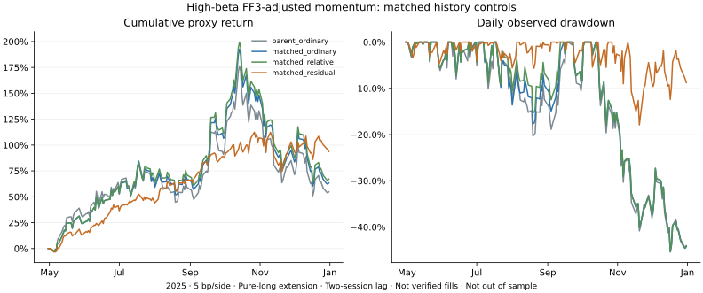

# 高贝塔因子调整动量：同历史资格对照实验

**结论：本样本中，因子调整评分相对同历史资格的普通动量，同时改善收益代理、观察回撤和个股正收益区间比例；值得进入独立验证，尚不升级 Paper。** 收益集中度较高，只有 8 次选股，历史价格路径已经暴露，不能认定找到了稳定高胜率策略。

## 实际结果

沿用原高贝塔池、价格／流动性／同行资格、每月 10 个 10% 名额及每板块最多两个名字，余款零息现金。8 次形成期从 2025-04-30 到 2025-11-28，第二个后续交易日收盘代理换仓，首期 2025-05-02 入场，标记至 2025-12-31。无额外波动缩仓、借贷或做空。以下不是券商可成交收益，不年化区间收益。

| 方案 | 5 bp/边收益代理 | 25 bp/边收益代理 | 5 bp观察回撤 | 个股毛收益正区间 | 组合正区间 |
|---|---:|---:|---:|---:|---:|
| 原普通动量，原资格 | +54.80% | +52.99% | 45.40% | 36/80（45%） | 4/8 |
| 普通动量，同历史资格 | +63.36% | +61.36% | 45.23% | 40/80（50%） | 4/8 |
| 板块相对动量，同历史资格 | +67.15% | +64.98% | 45.23% | 40/80（50%） | 4/8 |
| FF3 因子调整评分，同历史资格 | **+93.77%** | **+91.35%** | **17.89%** | **46/80（57.5%）** | **7/8** |



主要比较是第四行对第二行，而不是对原始池：5 bp 下收益代理多约 **30.41 个百分点**、观察回撤少约 **27.33 个百分点**、个股正区间多 **7.5 个百分点**。25 bp 下仍有同方向差异，因子调整方案观察回撤约 18.00%。增加完整历史资格本身已经把普通动量由 54.80% 改为 63.36%，这一部分不能算作新评分效果。

个股区间按每次计划持有起止的复权收盘价比较，未分摊个股交易成本，包含重复名字与相关时期；**不是实际交易胜率，也不是 80 个独立样本**。7/8 同样只是八个组合持有区间，不是统计显著性证明。

## 改善的范围与风险

- 四组平均日股票敞口均约 98.82%（包含形成后入场前现金日），因此差异不是本次缩仓造成。但相同总敞口不等于相同风险：形成时按原 252 日方法估计的加权 SPY β，匹配普通动量约 2.22、因子调整约 2.09。没有对真实组合做因子对冲或证明风险调整后 alpha。
- 与匹配普通动量的 80 个选股名额仅重合 23 个，和上轮两套原动量 79/80 名额相同的情形不同；本轮评分改变了大部分名单。它仍只有 8 次形成期，不能把名额数当作独立样本量。
- 因子调整方案先前涨幅较温和，后期回撤小于对照；这是本段价格路径的观察，不是未来不会崩溃的保证。即使本次最大回撤约 18%，它仍是高风险纯多头组合。
- **收益并不均匀。** 因子调整方案共选过 29 个不同名字，第一名贡献约 24.16% 的正向路径美元收益，前三名合计约 **55.10%**；匹配普通动量前三名约 38.07%。该指标核对了逐日路径贡献与成本后的净值，但不是删除赢家后的反事实收益，也不是已成交交易 P&L。
- 10%／20% 是换仓目标，并非持续上限；因子调整方案观察到的最大漂移单名权重约 17.60%、板块约 25.83%。

## 原文与具体实现

方法依据为 Blitz、Huij、Martens（2011），[*Residual Momentum*](https://repub.eur.nl/pub/22252/ResidualMomentum-2011.pdf)，DOI [10.1016/j.jempfin.2011.01.003](https://doi.org/10.1016/j.jempfin.2011.01.003)。本轮阅读接受稿引言、第 3 节（公式 1、截距讨论、脚注）及第 5.5 节；未声称完整复核全部结果。第 5.5 节专门讨论相同完整历史资格对照，因此本轮显式保留这一对照。

原方法以 36 个月月度股票超额收益拟合带截距 FF3 模型，再按跳过最近月的因子调整收益及其标准差排名。这里特别按照第 12 页“不把估计 alpha 纳入动量调整”的讨论，采用下列区分：

```text
拟合：y[m] = stock_return[m] - RF[m] = alpha + beta · FF3[m] + error[m]
排名输入：u[m] = y[m] - beta · FF3[m] = alpha + error[m]
评分：sum(last_11_u) / sample_sd(last_11_u)
```

截距保留在回归中以估计暴露，**不从排名输入再次扣除**；所以这里的 `u` 不等于完整 OLS 误差。测试专门区分这两种定义。原文未给出全部机器算术细节，本轮的加总方式和 sample sd（ddof=1）是公开冻结的实现约定，不声称取得了作者代码。

回归使用两次正交化的 QR；独立实现用 Decimal 正规方程检查。因子取自 [French 官方 FF3 与 RF 数据](https://mba.tuck.dartmouth.edu/pages/faculty/ken.french/Data_Library/f-f_factors.html)，按月对齐，源百分数仅除以 100 一次。CSV 年度行和使用范围外日期均不进入模型，缺失值不插值。

**与论文的区别：** 原文使用 CRSP 多空十分位及多个重叠持有期；本轮是高贝塔、固定归档池、板块约束的纯多头。为给因子发布留时间，回归窗口末月设为形成月的上一个月，比原文窗口额外后移一月。以 2025 年 4 月形成为例，回归收益为 2022-04 至 2025-03 的 36 个月，排名用 2024-05 至 2025-03 的 11 个月。这个日历滞后仍不能证明当时数据实际已发布；没有历史因子发布快照认证。

## 数据、初次中止及输入修订

[原协议](protocol.json)先于新数据抓取发布，第一版执行代码也先于任何新评分发布。新增历史请求覆盖 346 个原合格代码及 SPY 的 2022-03 至 2023-01，共 75,473 行、14 个原始响应页；其中 2023 年 1 月作为与旧缓存的重叠检查，不直接覆盖旧价格。

第一次运行在价格拼接检查处中止，**尚未计算评分或组合结果**：两个代码的新请求存在 2023 年 1 月记录，而旧缓存该月为空。不能确认额外历史是否属于相同经济股权。保留原协议、[初版哈希](code-seal.json)和输入失败收据哈希，并在新评分前发布 [RM1a 输入修订](input-amendment.json)及[当前执行哈希](code-seal-v2.json)：

- 隔离“旧重叠月为空、新重叠月非空”的代码之整段新增历史，不改其原有价格，不补旧缺值；随后按原定完整 36 个月条件筛选。
- 其余保留输入的重叠日期与价格仍必须完全一致；共同价格不一致等其他情形继续中止，没有放松容差或按收益排除名字。
- 原假设、评分、日期、成本和四组对照均未改变。本次属于分析结果前的数据有效性修订，并非可以把旧失败视为不存在的“零改动预注册”。发布顺序见[记录](publication.json)。

其余新旧价格共核对 6,520 个重叠股票—交易日，未发现差异；这不能认证更早全部证券身份。每个形成期从原有资格中，按实际可用历史与有效模型产生共同候选集，不要求未来月份完整，也不通过未来持仓价格完整性选股。

| 形成日 | 原合格代码数 | 匹配代码数 |
|---|---:|---:|
| 2025-04-30 | 187 | 177 |
| 2025-05-30 | 206 | 195 |
| 2025-06-30 | 234 | 218 |
| 2025-07-31 | 249 | 232 |
| 2025-08-29 | 261 | 245 |
| 2025-09-30 | 261 | 245 |
| 2025-10-31 | 277 | 262 |
| 2025-11-28 | 269 | 252 |

实际剔除原因均为月度股票历史缺失。完整 36 个月价格不等于公司或当前经济股权已经上市 36 个月，SPAC／更名／重组等身份问题未获全面认证。匹配板块相对动量保留原同行均值，仅限制候选列表，没有重算成另一套同行定义。

French 文件为当前回溯版本。[官方数据说明](https://mba.tuck.dartmouth.edu/pages/faculty/ken.french/data_library.html)提示 2025 年起从 FIZ 切换至 CIZ，月收益分红再投资口径有变；本轮不是当年的文件快照，也不是 2011 年论文原始因子版本。股票则是供应商复权收盘价代理。两类来源的会计与点时局限均保留，不能宣称精确论文复制或真实账户收益。

## 核验与决定

12 项新增离线测试与原来的 11 项测试通过；8 次原始形成数据重算一致。独立 Decimal 实现检查了 **1,826 条**合格股票—形成期模型，8 个成本案例均通过原有独立名义账户审计；个股正区间数量另外用起止价格大小比较独立核对。模型数、成本案例数包含相关或重复输入，不是独立统计样本数。

原普通动量两档成本的逐日净值完全复现。[结果](results.json)、[输入哈希清单](input-manifest.json)、[验证记录](validation.json)和[原文文件收据](paper-receipt.json)公开；原始价格、因子 ZIP、逐股模型、隔离代码与持仓留在私有 `work/`。所有既有跟踪文件和 156 个核心文件未改动。无订单、付费采购、2026 SOXL 价格读取或自动推广；广泛高贝塔对照仍未恢复全期结果。

**决定：保留这项候选，下一步做独立验证，不在 2025 年曲线上继续优化。** 先检查哪些时期及标的尚未参与调试，再注册验证区间与判定条件；同时检查收益集中与证券身份风险。只有新证据能决定是否进入受限 Paper，当前结果不足以证明稳定高胜率或可实现盈利。

## 复算

需要保留的私有父研究输入和缓存。首次抓取需现有 Alpaca 权限；计算与审计不联网。当前入口使用 RM1a 及 v2 哈希，初版哈希仅记录被中止的执行版本。

```sh
python research/residual-momentum/capture.py --source work/sector-momentum --output work/residual-momentum
python research/residual-momentum/runner.py --source work/sector-momentum --root work/residual-momentum
python research/residual-momentum/summarize.py --root work/residual-momentum --output docs/research/residual-momentum
python research/residual-momentum/plot.py --results docs/research/residual-momentum/results.json --output docs/research/residual-momentum/equity.svg
python -m unittest discover -s research/residual-momentum -p "test_*.py" -v
python -m unittest discover -s research/sector-momentum -p "test_*.py" -v
```
