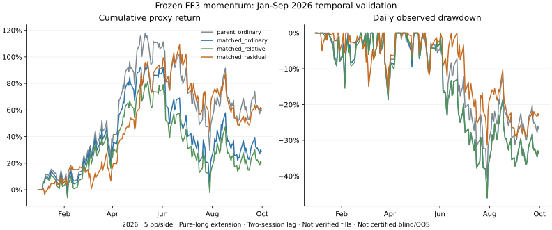

# 因子调整动量：2026 年时间分离验证

**结果：RV1a 完成检验，但预先登记的研究筛选为 FAIL。** 因子调整评分保留了正收益和相对匹配普通动量的改善，不过两档成本下最大回撤都超过 25% 的研究预算。本轮不将满仓方案升级 Paper，不提高回撤门槛，也不改持有期或验证区间。

初始 RV1 曾在输入接缝检查处中止；其记录原样保留。后续仅在新评分前注册了“隔离可证明始终不合格的新增历史”的 RV1a 输入修订，评分、交易规则与通过条件没有改变。这不是完全零修订的预注册试验，也没有认证为完全盲测。

## 结果与预定判定

固定原 2025 年归档池，不添加后来上市股票。9 次月末形成期从 2025-12-31 至 2026-08-31，首期在第二个后续交易日 **2026-01-05** 收盘代理入场，标记至 **2026-09-30**。资本独立重置为 100,000 美元，不承接 2025 年利润；股票目标和板块限制、现金、时滞及成本公式沿用父研究，无新增波动缩仓。下表不年化，收益为未验证成交的复权收盘价代理。

| 方案 | 5 bp/边收益代理 | 25 bp/边收益代理 | 5 bp观察回撤 | 个股毛收益正区间 | 组合正区间 |
|---|---:|---:|---:|---:|---:|
| 原普通动量，原资格 | +59.48% | +56.95% | 40.62% | 48/90（53.3%） | 6/9 |
| 普通动量，同历史资格 | +28.82% | +26.86% | 46.10% | 43/90（47.8%） | 6/9 |
| 板块相对动量，同历史资格 | +20.18% | +18.44% | 46.10% | 43/90（47.8%） | 6/9 |
| FF3 因子调整，同历史资格 | +60.78% | +58.56% | **31.35%** | 53/90（58.9%） | 6/9 |



全部 8 个成本案例完成全期标记和审计。25 bp 下因子调整回撤约 **31.43%**。模型并未亏损，但利润为正不等于满足风险约束。

[协议](protocol.json)在新股票价格抓取前登记以下筛选；这些是 DX27 的研究预算选择，**不是论文的显著性门槛，也不是用户承诺的风险上限**。两档成本均须满足：

| 条件 | 实际判定 |
|---|---|
| 匹配普通动量与因子调整均完整完成 | 通过 |
| 因子调整收益为正 | 通过 |
| 因子调整收益超过匹配普通动量 | 通过 |
| 因子调整回撤不高于匹配普通动量 | 通过 |
| 因子调整回撤不超过 25% | **未通过** |
| 个股毛收益正区间比例至少 50%，且不低于匹配对照 | 通过 |

所有条件同时成立才给 PASS；完整但至少一项未达标为 FAIL；输入／持仓缺值使主要比较无法完成则为 INCOMPLETE。本次最终 FAIL 由回撤预算项触发，不能因收益好看而改为通过，也不能把它解释成策略亏损。

## 改善与局限

- 对同历史资格普通动量，因子调整在 5 bp 下收益多约 31.96 个百分点，回撤少约 14.75 个百分点；但对不增加完整月历史限制的原普通动量，收益仅多约 **1.30 个百分点**，回撤少约 9.27 个百分点。2026 年历史资格限制使普通动量变差，不能只展示较弱的对照。2025 年该限制曾提高普通动量收益，方向并不稳定。
- 四组平均日股票敞口都约 98.94%，包含入场前现金日；不是缩仓对比。形成时 252 日 SPY 加权 β，匹配普通动量约 2.79、因子调整约 2.42；相同总敞口不等于风险匹配，更不能证明 alpha 或纯多头因子中性。
- 因子调整最大回撤对应 **2026-06-22 峰值至 2026-07-29 谷值**；这是路径定位，不是已识别的宏观因果，也不据此增加事后卖点。此前选择的股票仍有很高市场暴露，排名调整没有消除账户风险。
- 因子调整方案共有 29 个不同名字，前三名贡献约 **49.34% 的正向路径美元收益**。这不是删除赢家后的反事实收益。最大漂移单名权重约 17.70%、板块约 25.74%；10%／20% 仅是换仓时目标，不是持续上限。
- 53/90 按个股每次持有起止的毛价格变化计数，不分摊个股交易成本；同名跨月重复且区间相关，**不是 90 笔独立交易或真实扣费胜率**。因子调整与匹配普通动量的名单重合 20/90 个名额；独立决策期只有 9 个。

## 时间分离的证据范围

取新价格前，审计保留的 12,892 份请求元数据，其中股票行情请求 12,854 份，未发现覆盖 2026 年或日期不限定的股票请求。[审计摘要](exposure-audit.json)和协议保留原私有收据哈希。未读取预留的 2026 SOXL 价格；抓取层还显式拒绝该代码。

这仅覆盖保留的请求元数据。未记录查询、已有 Paper 快照、外部市场知识及其他渠道的观看无法排除。父研究保留的 French 当前 ZIP 包含较新月份，但旧评分解析器未使用这些月份；本轮使用同一哈希文件中的 2022-12 至 2026-07 月度行。因子发布历史仍无认证，整月滞后只是缓冲假设。因此这里称为**回顾性的时间分离检验**，不称为前瞻盲测或已认证完全独立样本外试验。原论文方法与阅读范围见[父研究](../residual-momentum/README.md)，本轮未重调模型。

## 首轮中止与输入修订

新旧 2025 年 12 月重叠检查发现 8 个代码：旧缓存整月为空，新请求却返回了该月记录。第一轮在新评分前按原协议中止，见[原始中止记录](initial-abort.json)。仅凭代码相同，不能把新旧经济股权当成连续持有历史。

公开的公司行动给出身份风险例证：[BRKL 并购完成通知](https://www.nasdaqtrader.com/TraderNews.aspx?id=ECA2025-467)、[Aris 收购完成公告](https://investors.westernmidstream.com/2025-10-15-WESTERN-MIDSTREAM-COMPLETES-ACQUISITION-OF-ARIS-WATER-SOLUTIONS)。它们不能独立认证其余全部问题代码或证明新响应具体映射到了谁；本轮没有把这些响应当作可信后继股权价格。

新评分／收益计算前，发布 [RV1a 输入修订](input-amendment.json)：仅当旧 12 月**整月无记录**、新月非空，而且预定九个形成期的每一个 253 收盘窗口都含旧缺失日，才隔离该代码**整段新增 forward 历史**。原归档池和旧价格不变，不补旧缺值；同代码原始新行情也不进入计算。

实际检查证明这 8 个代码在每个形成期的必要窗口内都至少缺 22 个旧日期，所以按原来的完整性要求，本来就不能进入基础同行池或合格池。隔离并非看了 2026 收益再排除赢家或输家，也没有放宽共同价格容差；任何其他接缝矛盾仍中止。该证明只适用于本轮区间，若未来缺口滚出窗口便不能自动沿用；测试会拒绝这种情况。

这是输入审查后的显式修订，而不是未修改的初始登记。保留[首版执行哈希](code-seal.json)、[当前执行哈希](code-seal-v2.json)与[发布顺序](publication.json)。历史补段继续使用父研究 RM1a 的旧 2023 年 1 月为空／新段非空隔离规则，共隔离另外 4 个历史补段；不填原缺失月。

## 数据与数值核验

- 新 forward 复权与原始日线各 784,589 行，较早历史 235,341 行；285 个原始响应页。保留数据的 forward 接缝核对 84,727 个复权股票—交易日及 84,705 个原始收盘价／成交量元组。SPY 多出的 22 个复权观察仅作基准，其旧原始缓存不存在且从不进入股票流动性池；新 SPY 原始记录未使用。
- 更早历史接缝另核对 75,977 个观察；French 因子保留 44 个月。2025-12 至 2026-09 的新 SPY 交易日与固定版本 `exchange_calendars 4.13.2` XNYS 日历一致。
- 9 项新增测试、12 项父模型测试和 11 项原组合测试通过。独立核查 2,958 条原资格特征、2,790 条 FF3 评分，8 个案例通过独立名义账户审计；8 组个股正区间计数另按起止价格大小独立重算。共 1,504 个逐日净值标记，包含多个相同来源成本案例，并非独立统计样本。
- 所有既有跟踪文件和 156 个核心文件保持不变。公开[完整聚合结果](results.json)、[输入哈希](input-manifest.json)与[验证记录](validation.json)；原始价格、因子 ZIP、逐股模型、隔离代码和详细持仓仍在私有 `work/`。

数据仍有固定归档池覆盖、历史行业／经济股权身份和当前复权／因子版本限制。完整价格路径不等于已认证可交易证券；名义成本也没有验证报价、零碎股、券商公司行动和税费。没有订单、付费数据采购、实盘资金操作或自动 Paper 推广。

## 后续决定

保留因子调整信号作候选，**满仓版本不通过当前研究筛选**。下一步是单独规定账户资金预算和前向影子验证，而不是把 25% 改成 35%、换回测月份，或按已知回撤优化止损。缩小配置可能降低账户风险，同时减少收益；它不会创造高胜率，也不能保证未来回撤。任何新版本需重新登记并用新证据验证。

## 复算

需要保留私有父研究缓存、归档池及相同 French ZIP；首次抓取依赖已配置的 Alpaca 数据权限。计算和审计不联网。当前入口使用 RV1a 的 v2 哈希；原 RV1 中止记录不删除。

```sh
python research/residual-validation/capture.py --output work/residual-validation
python research/residual-validation/validation.py --root work/residual-validation
python research/residual-validation/publish.py --root work/residual-validation --output docs/research/residual-validation
python research/residual-validation/plot.py --results docs/research/residual-validation/results.json --output docs/research/residual-validation/equity.svg
python -m unittest discover -s research/residual-validation -p "test_*.py" -v
python -m unittest discover -s research/residual-momentum -p "test_*.py" -v
python -m unittest discover -s research/sector-momentum -p "test_*.py" -v
```
