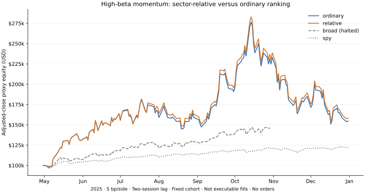

# 高贝塔板块相对动量：冻结规则后的首轮诊断

**结论：暂不升级 Paper。** 板块相对评分的代理收益为正，但回撤很大，正收益持有区间比例没有提高；两组仅一次选股存在一只股票的差异。它提供了可继续研究的动量基线，尚未验证高胜率策略。

## 研究结果

2025-04-30 形成首个信号，2025-05-02 收盘代理入场，最后标记日为 2025-12-31。共 8 次月度选股，每次 10 个等权名额。样本已经暴露，不是独立留出集；不年化短样本。**以下为供应商复权收盘价的组合代理，未验证实际成交、券商分红再投资或真实账户收益。**

| 评分／对照 | 5 bp/边代理收益 | 25 bp/边代理收益 | 5 bp观察回撤 | 股票正收益区间 |
|---|---:|---:|---:|---:|
| 普通动量 | +54.80% | +52.99% | 45.40% | 36/80（45%） |
| 板块相对动量 | +58.47% | +56.49% | 45.40% | 36/80（45%） |
| 广泛高贝塔对照 | 中止，不给全期收益 | 中止，不给全期收益 | — | — |
| SPY参考 | +21.30% | +21.06% | 5.07% | — |



“股票正收益区间”按每次持有区间的复权价格变化计数，未按个股分摊组合换仓成本；包含重复股票与相关时期，**不是实际成交胜率，也不是 80 个独立样本**。两种选股组合均只有 4/8 个篮子持有区间为正。SPY 仅作参考，其风险与高贝塔组合不同。

## 差距与风险

- 基础成本下，相对评分比普通动量高 3.67 个百分点；压力成本下高 3.50 个百分点。7 次形成期名单相同，另一次仅替换一个名额，总重合度为 79/80。不能据此认定同行调整有稳定额外预测能力。
- 减去同组常数不会改变组内排名；排除自身的均值同样保留组内次序。本实验的差异主要来自不同板块之间的名额分配，并不是已经验证“行业中性”的额外个股 alpha。
- 形成时加权 β 均约 2.28，β 由事件前 252 个对齐日收益估计。高于 SPY 的代理收益不能直接解释为风险调整后超额收益。
- 两种评分都出现约 45.40% 的观察回撤。10% 个股／20% 板块限制是换仓时的目标；持有期间会漂移。相对评分的最大漂移个股权重约 17.84%，板块约 27.78%。
- 相对评分共有 27 个不同入选名字；前三名贡献了正向路径美元收益约 41.74%。这不是删除赢家后的反事实收益，也不能据此证明收益稳定。
- 广泛高贝塔对照在 2025-10-30 因持仓复权收盘价缺失而中止。保留中止记录与截断曲线，不用中止前收益参与全期比较，因此对广泛高贝塔暴露的完整归因仍未解决。

## 文献与规则出处

[完整书目、版本与阅读范围](literature.json)区分了行业轮动、行业内相对动量与因子残差动量。本轮没有声称逐篇完整复现。

| 依据 | 本轮采用／保留的边界 |
|---|---|
| [Asness、Porter & Stevens（2000）](https://www.aqr.com/Insights/Research/Working-Paper/Predicting-Stock-Returns-Using-IndustryRelative-Firm-Characteristics) | 相对同行特征的假设依据；高贝塔、流动性和仓位规则是本研究扩展 |
| [Moskowitz & Grinblatt（1999）](https://www.aqr.com/Insights/Research/Journal-Article/Do-Industries-Explain-Momentum) | 行业收益延续与个股动量相关；行业轮动与本次个股相对评分有不同信号 |
| [French 动量构造说明](https://mba.tuck.dartmouth.edu/pages/faculty/ken.french/Data_Library/det_mom_factor.html) | 采用 prior 2–12 的跳月惯例；本组合不复刻其多空因子 |
| [Blitz、Huij & Martens（2011）](https://repub.eur.nl/pub/22252/ResidualMomentum-2011.pdf) | FF 因子残差动量单列，不把简单板块均值相减叫作同一方法 |
| [Daniel & Moskowitz（2016）](https://www.nber.org/papers/w20439) | 注意事前暴露和崩溃风险；论文短端反弹机制与本次长端高贝塔回撤不能直接等同 |
| [Li（2022）](https://www.sciencedirect.com/science/article/pii/S1544612322001490)、[Mamais 等（2025）](https://onlinelibrary.wiley.com/doi/10.1002/for.3232) | 分类与时期差异需要检查；近期相关研究没有直接验证本轮组合 |
| [Barroso & Santa-Clara（2015）](https://novaresearch.unl.pt/en/publications/momentum-has-its-moments/) | 风险预算可作为下一项单独注册研究；降低仓位并不会凭空创造高胜率 |

## 冻结方案与数据边界

[协议](protocol.json)在新数据抓取与结果计算前发布，[执行代码哈希](code-seal.json)在第一次计算结果前发布；见 [发布记录](publication.json)。无结果后的阈值、股票或持有期搜索。

- 固定归档股票池 4,002 个名字，以 SPY 为 β 参考；新增日线 2,935,619 行，81 个规范化批次、321 个原始响应页。原始数据与详细持仓留在私有工作区，公开 [输入清单](input-manifest.json) 的哈希及计数。
- 过去 252 个对齐日收益 β≥1.5；原始价格≥5 美元、过去 20 日平均美元成交量≥2,000 万；每个名字至少 10 个其他合格同行。同行池包含低贝塔名字。
- 两组均使用 prior 2–12 收益，月末形成目标、第二个后续交易日收盘才换仓；10 个 10% 名额、每板块最多两个、余款零息现金。相对评分减去同板块其他合格名字的等权平均收益。
- 固定价格、β、流动性、权重和时滞是 DX27 研究选择。归档大类板块不是完整历史 SIC 行业；股票池不保证动态历史资格与退市覆盖；当前供应商复权版本也不是当年的发布快照。
- 收盘价代理隐含分红等复权收益处理，未验证券商再投资、零碎股、税费、公司行动权利与成交价差／深度。两档成本按漂移后的名义换仓金额计收，并用成本后权益求目标仓位，不能把结果当作可成交收益。
- 任何持仓缺值均中止该组；不以未来数据完整性筛选赢家。不读取预留的 2026 SOXL 价格，不下单、不自动推广。

## 核验与后续决定

11 项离线测试通过，独立检查重算了 1,944 条合格特征，并对 8 个案例的名义持仓、现金、成本、时序及代理净值核账。包含中止案例的审计通过仅指已观察路径一致；不证明全期完整性、来源真实性或成交可实现。[机器结果](results.json)与 [验证记录](validation.json)保留所有案例。

后续优先处理缺值对照的身份／公司行动问题，再单独注册事前风险预算与更长历史检验。保留本轮两种评分作为固定基线，不在当前样本继续搜索 β 门槛或止损参数。风险管理与提高信号命中率是两项不同任务；当前尚未找到通过验证的高胜率策略。

复算需要保留的归档股票池、旧原始日线、交易日历和本轮缓存；首次取数依赖已配置的 Alpaca 权限。供应商原始数据不随公开仓库分发，哈希用于核对保留输入，不能替代公开的完整数据包。

```sh
python research/sector-momentum/capture.py --output work/sector-momentum
python research/sector-momentum/study.py --root work/sector-momentum
python research/sector-momentum/summarize.py --root work/sector-momentum --output docs/research/sector-momentum
python research/sector-momentum/plot.py --results docs/research/sector-momentum/results.json --output docs/research/sector-momentum/equity.svg
python -m unittest discover -s research/sector-momentum -p "test_*.py" -v
```
