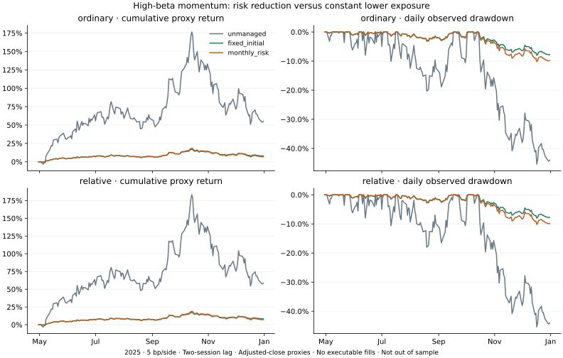

# 高贝塔动量：事前风险预算实验

**结论：缩仓降低风险；本轮没有显示按月动态风险预算优于首期比例固定。暂不升级 Paper。** 这项扩展没有改善选股信号，不能把减仓后的回撤下降解释成发现高胜率策略。

## 实际结果

沿用原来的两套选股规则、8 次形成期、第二个后续交易日收盘换仓及 2025-12-31 末次标记。首次代理入场为 2025-05-02。不年化这段收益；不是独立留出样本；复权收盘价与固定成本仅是代理，未验证可成交报价、券商分红再投资或账户会计。

| 选股规则 | 仓位方案 | 5 bp/边收益代理 | 25 bp/边收益代理 | 5 bp观察回撤 | 平均日股票敞口 |
|---|---|---:|---:|---:|---:|
| 普通动量 | 未缩仓 | +54.80% | +52.99% | 45.40% | 98.82% |
| 普通动量 | 首期比例固定 | +8.00% | +7.81% | 8.03% | 14.06% |
| 普通动量 | 按月风险预算 | +6.86% | +6.66% | 10.19% | 15.85% |
| 板块相对动量 | 未缩仓 | +58.47% | +56.49% | 45.40% | 98.82% |
| 板块相对动量 | 首期比例固定 | +8.36% | +8.16% | 8.03% | 14.08% |
| 板块相对动量 | 按月风险预算 | +7.22% | +7.00% | 10.19% | 15.86% |

平均日敞口包含形成后、入场前的现金日，也包含持有期间的权重漂移。25 bp 下，未缩仓观察回撤约 45.57%、固定比例约 8.06%、动态预算约 10.24%。[全部 12 个案例、净值和风险计划](results.json)均保留，不筛选最好看的结果。



## 怎样理解结果

1. **回撤下降伴随大幅减仓和收益减少。** 动态方案相对原组合回撤下降约 35.21 个百分点，但约 84% 的平均日权益留在零息现金。以相对动量为例，收益代理由 58.47% 降为 7.22%；这不是免费保护。
2. **本轮没有支持动态复杂度的增量证据。** 与首期比例固定相比，动态方案的相对动量收益低约 1.14 个百分点，回撤高约 2.16 个百分点；普通动量也相同方向。两组平均敞口并不完全匹配，因此这不是把择时效应与风险量严格分离的因果估计，不能推断动态方法普遍无效。
3. **风险估计存在滞后。** 动态比例从首期约 13.52%，在 10 月末形成时升到约 18.63%；此前估计风险下降，随后 11 月、12 月持有区间为负，动态方案承受了更大的负向幅度。这是本样本的路径描述，不是事后应当卖出的新信号。没有据此缩短窗口或加入止损。
4. **预测风险与实际风险不是同一件事。** 当前篮子的 126 日年化风险估计约 64%–94%；12% 目标因而只给出约 13%–19% 的目标股票敞口。动态方案观察到的持有期日收益年化标准差约 11.30%，固定比例约 9.81%；这是短样本描述，不证明未来会守住 12%，更不是最大回撤上限。月内不连续调整风险。
5. **选股命中率问题仍在。** 入选股票、持有起止日期及正的仓位符号不变，原来 36/80（45%）的个股毛收益为正区间定义也不变；它仍不是实际扣费交易胜率或 80 个独立样本。本次所有方案的组合持有区间都只有 4/8 为正。

## 文献核对与方法扩展

[作者主页](https://sites.google.com/site/pedromsbarroso/)列出 Barroso 与 Santa-Clara 的 *Momentum has its moments*，发表于 JFE 116(1), 2015, 111–120，DOI [10.1016/j.jfineco.2014.11.010](https://doi.org/10.1016/j.jfineco.2014.11.010)。本轮可读的具体方法来自[作者 2013 年 11 月稿的镜像转录，第 4 节公式 5–6](https://www.readkong.com/page/momentum-has-its-moments-cid-3-pedro-barrosoy-and-pedro-5988789)：以前 126 个交易日的多空动量收益平方估计风险，用逆波动率缩放，并采用 12% 年化参考目标。

同时取得并读完[作者主页所链接的勘误](https://drive.google.com/file/d/1G9zsx25zs7ijIdjf8VDmmgz7vPIcQSTW/view?usp=sharing)：刊出公式 10 的换手表达式应按缩放后仓位的绝对变化计算；勘误说明论文相关结果已经采用正确表达式，不能宣称其结果因此失效。本研究逐笔使用缩放、漂移和成本后的股票名义金额计算交易成本，没有将收益乘比例后忽略换仓成本。

**阅读范围限制：没有取得完整 2015 年刊出正文，作者链接的复现包也未取得有效可读压缩包。** 本轮未运行第三方复现代码，不称为刊出版逐式复现。所读作者稿是第三方镜像转录，不是已认证作者 PDF；勘误 PDF 留在私有目录并公开哈希。[书目与阅读范围](literature.json)保留上述区别与访问限制。

论文对象是有既往实际收益序列的多空 WML，而我们是固定池高贝塔纯多头。直接用只有 5 月起的策略净值无法给 4 月形成期提供 126 日预热。本轮明确采用以下 **DX27 扩展**，不虚构策略持仓历史：

- 每次月末先按原规则选出篮子，取截至形成日的 127 个精确历史收盘价，得到 126 个收益；原有合格规则已要求更长完整历史。
- 计算 `basket_return[d] = sum(original_slot_weight[i] * stock_return[i,d])`，再用 `sqrt(252 * mean(basket_return**2))` 估计年化风险。先合成篮子再平方，保留股票间共同波动；不减均值。
- 这里是“当前所选篮子假设过去每日保持该权重”的回看序列，**不是过去真的持有过这个篮子，也不是论文的已实现策略收益序列**。它在形成时可算，但选股条件与历史路径相关，预测能力需另行验证；日内收益、跳空和当前供应商复权版本仍有限制。
- 未缩仓比例为 1；动态比例为 `min(1, .12 / forecast)`；固定对照在每套信号首期计算一次该比例，随后保持。无借贷、做空或结果后的平均敞口拟合。零风险估计取比例 1，未选满名额继续保留现金。
- 所有目标都在第二个后续交易日收盘代理执行，只按月更新，月内允许漂移；用成本后权益求资金充足的目标，现金零息。目标估计无效或持仓缺价不插值，不以未来完整性改名单。

## 冻结、核验及未解决问题

[协议](protocol.json)和[执行代码哈希](code-seal.json)分别在本轮结果计算前发布，见[发布记录](publication.json)。不过原数据与父策略路径早已暴露，此顺序不能使本样本成为独立样本外检验。没有尝试不同波动目标、窗口、退出点或股票门槛。

10 项新增测试加原有 19 项测试通过。独立 Decimal 实现重新计算了 12 个案例中的 96 次风险预测，并核对共 2,040 个逐日净值标记、固定目标、时滞、名义换手和自融资成本方程。96 次包含多个成本／方案的重复输入，不是 96 个独立形成期。四个未缩仓案例的整条净值与父实验完全一致；8 次原始形成数据重新计算后逐项一致。[核验记录](validation.json)区分数值核账和来源／成交认证。

原股票池的历史覆盖与行业身份未获点时认证，复权价格不是当年的发布快照。广泛高贝塔对照仍保留并购中止，见[公司行动排查](../sector-action-review/README.md)，所以仍不能给出完整风险匹配对照或声称已识别 alpha。所有既有跟踪文件和 156 个核心文件未改动。无新行情请求、付费采购、预留 2026 SOXL 价格读取或订单。

**决定：不把动态预算作为已验证策略，也不把固定低仓位对照自动推广为交易方案。** 本轮只记录了本样本的风险／收益交换，并否定了在这段样本上增加动态复杂度的必要性。保留固定低仓位对照，后续重点转向能否改善信号本身；因子残差动量等新假设需先核对原文方法、取得对应输入，再独立冻结并扩展历史／留出验证。继续调整本样本止损或波动窗口不能补上高胜率证据。

## 复算

需要保留的私有 SM1 输入、原始形成文件与价格缓存；公开哈希不是完整公开数据集。计算与核账无需联网，原始价格及详细持仓不随仓库分发。

```sh
python research/sector-risk/study.py --source work/sector-momentum --output work/sector-risk
python research/sector-risk/plot.py --results work/sector-risk/results.json --output work/sector-risk/equity.svg
python -m unittest discover -s research/sector-risk -p "test_*.py" -v
python -m unittest discover -s research/sector-momentum -p "test_*.py" -v
python -m unittest discover -s research/sector-action-review -p "test_*.py" -v
```
